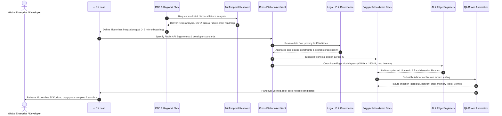

# 🌐 TUM Universal Omnichannel Identity & AI Ecosystem — AI Subagent Framework

> **Universal Multi-Agent System designed for Claude, ChatGPT, and Google Gemini**  
> Born in the physical crucible of self-service Kiosks, scaled to ubiquitous global adoption across Mobile, Web, Cloud, Smart POS, and Enterprise Infrastructure.

---

## 🏛️ Ecosystem Overview

This subagent system organizes **34 specialized AI roles** across **8 foundational pillars** anchored by a unified master strategy:

```
.subagents/
├── VISION_AND_STRATEGY.md                  <-- ⭐ Master Omnichannel Vision, Moats & Roadmap
├── README.md                               <-- Master Architecture & Overview Guide
├── SETUP_CLAUDE.md                         <-- Setup for Claude Code, Claude Desktop & Projects
├── SETUP_CHATGPT.md                        <-- Setup for ChatGPT Custom GPTs & System Instructions
├── SETUP_GEMINI.md                         <-- Setup for Google Gemini Gems & Instructions
├── roster.json                             <-- Machine-readable registry of all 34 agents
│
├── 01-executive-strategy/                  <-- Pillar 1: High-level tech, AI & global identity strategy
├── 02-tri-temporal-research/               <-- Pillar 2: Past (Legacy), Present (SOTA), Future (Frontier)
├── 03-global-product-management/           <-- Pillar 3: US, EU, APAC Regional PMs, Global BA, PM, Scrum
├── 04-dx-architecture/                     <-- Pillar 4: DX Lead, Cross-Platform Architect, Lead Dev, UI/UX, Solutions
├── 05-polyglot-sdk-engineering/            <-- Pillar 5: C#, Java/Android, Swift/iOS, Flutter/RN, TS, Python, C++
├── 06-hardware-quality/                    <-- Pillar 6: Kiosk Hardware, OEM Partner Lead, Chaos QA
├── 07-ai-biometrics-lifecycle/             <-- Pillar 7: AI PM, Feature Eng, Data Scientist, AI Dev, Edge AI
└── 08-security-governance-legal/           <-- Pillar 8: Red Team, Legal, AI IP, Data Governance, DevOps
```

---

## 🧭 The 8 Pillars Matrix

| Pillar | Subagent ID | Role Title | Core Mission |
| :--- | :--- | :--- | :--- |
| **1. Executive & Strategy** | `cto` | Chief Technology Officer | Global tech strategy, system architecture, business alignment |
| | `global-ai-product-head` | Global Head of AI & Product | International product roadmap & AI innovation leadership |
| | `global-identity-architect` | Global Identity Standards Architect | mDL (ISO 18013-5), eIDAS 2.0, W3C DID/VC, OID4VP |
| **2. Tri-Temporal Research** | `legacy-retro-researcher` | Legacy & Retro-Systems Researcher | Analyze historical failures, legacy hardware (ISO 7816, RS-232, Windows Embedded) |
| | `current-sota-researcher` | Current & Market SOTA Researcher | FIDO2, Passkeys, OAuth 2.1, competitor benchmarks, immediate product signals |
| | `frontier-future-researcher` | Frontier & Next-Gen Tech Researcher | Post-Quantum Cryptography (PQC), Zero-Knowledge Proofs (ZKP), Next-Gen Biometrics |
| **3. Global Product Management** | `regional-pm-us` | Regional PM (US) | NIST SP 800-63, REAL ID Act, US cloud & enterprise compliance |
| | `regional-pm-eu` | Regional PM (EU) | eIDAS 2.0, strict GDPR, EU Digital Identity Wallet specifications |
| | `regional-pm-apac` | Regional PM (APAC) | ThaID, Singpass, Aadhaar, APAC digital identity government frameworks |
| | `international-ba` | International Business Analyst | Cross-border requirement localization & multi-lingual technical specs |
| | `project-manager` | Project Manager (PM) | Milestones, delivery timelines, dependencies, cross-team budget |
| | `scrum-master` | Scrum Master | Agile process execution, daily unblocking, sprint efficiency |
| **4. DX & Architecture** | `dx-lead-sdk-ergonomics` | ⭐ DX Lead & SDK Ergonomics Architect | Frictionless integration, 5-minute Time-to-First-Verification, Scaffolding, Docs |
| | `cross-platform-software-architect`| Cross-Platform Software Architect | Clean Architecture, Native AOT, cross-OS portability (Windows, Linux, Android) |
| | `lead-dev-code-quality` | Leader Dev & Code Quality Gatekeeper | Code review standards, PR gatekeeping, technical debt prevention |
| | `global-solutions-architect` | Global Solutions Architect | Enterprise onboarding, banking/government legacy system integration, client PoCs |
| **5. Polyglot SDK Engineering** | `csharp-dotnet-sdk-engineer` | Core C# / .NET SDK Engineer | .NET Standard 2.0 / 8 / 10, NuGet package, memory & async optimization |
| | `java-kotlin-android-engineer` | Java / Kotlin & Android Systems Engineer | Android Kiosks, Smart POS terminals (Sunmi, Pax), BiometricPrompt, AOSP |
| | `swift-ios-engineer` | Swift & iOS Systems Engineer | iPad Kiosks, Apple Wallet, ISO 18013-5 mDL, CoreNFC |
| | `cross-platform-mobile-engineer` | Cross-Platform Mobile Engineer | Flutter & React Native wrapper plugins (`TUM_identity_sdk`) |
| | `typescript-web-engineer` | TypeScript / Node.js & Web Engineer | Web SDK, Electron-based kiosks, Wasm bindings, NPM packaging |
| | `python-ai-pipeline-engineer` | Python SDK & AI Pipeline Engineer | PyPI library, data science integration, enterprise AI backend pipelines |
| | `cpp-native-systems-engineer` | C/C++ & Native Systems Engineer | High-speed C++ core, libusb, PC/SC interop, embedded Linux & IoT |
| **6. Hardware & Quality** | `kiosk-hardware-systems-engineer` | Kiosk & Hardware Systems Engineer | Smart card readers, cameras, session auto-reset, hardware failover handling |
| | `global-oem-partner-lead` | Hardware Ecosystem & OEM Partner Lead | OEM driver certification (HID Global, Thales, Zebra, Ingenico), HAL standards |
| | `qa-automation-chaos-tester` | QA Automation & Chaos Tester | Zero-Bug standard, extreme stress testing, network flapping, card jam simulation |
| **7. AI & Biometrics Lifecycle** | `ai-product-manager` | AI Product Manager | Biometric vision, face liveness, anti-fraud algorithms, AI kiosk assistant |
| | `feature-engineer` | Feature Engineer | Image preprocessing, facial vector extraction, high-signal embeddings |
| | `data-scientist` | Data Scientist | Model architecture training, FAR/FRR optimization, bias prevention |
| | `ai-developer` | AI Developer | Packing ML models into lightweight SDK features & offline libraries |
| | `applied-ai-edge-engineer` | Applied AI Engineer (Kiosk Edge/ONNX) | Edge deployment, ONNX Runtime, OpenVINO, memory footprint < 150MB |
| **8. Security, Governance & Legal** | `cybersecurity-anti-tamper-specialist` | Cybersecurity & Anti-Tamper Specialist | Public kiosk physical attacks, ISO 30107 PAD (anti-spoofing), memory scraping |
| | `legal-compliance-attorney` | Legal & Compliance Attorney | PDPA, GDPR, global financial e-KYC regulations, cross-border data transfer |
| | `ai-copyright-ip-specialist` | AI Copyright & IP Specialist | Training data rights, AI output ownership, model IP indemnities, global EULA |
| | `data-governance-specialist` | Data Governance Specialist | Data classification (PII, CID, Laser code), retention & masking rules |
| | `cloud-infra-devops-engineer` | Cloud, Infra & DevOps Engineer | Network resilience, container platforms, CI/CD, proactive telemetry & monitoring |

---

## 🔄 End-to-End Collaboration Flow



---

## 🚀 Quick Setup by Platform

Read the dedicated platform setup guides:
* 🟢 **Claude:** See [SETUP_CLAUDE.md](./SETUP_CLAUDE.md) for Claude Code, Claude Projects, and Custom Skills integration.
* 🟢 **ChatGPT:** See [SETUP_CHATGPT.md](./SETUP_CHATGPT.md) for Custom GPTs, Team Workspaces, and System Instructions.
* 🟢 **Google Gemini:** See [SETUP_GEMINI.md](./SETUP_GEMINI.md) for Gemini Gems, Google AI Studio, and API System Prompts.
