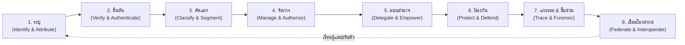

# 🌐 TUM Universal Identity & Trust Governance Ecosystem
## Master Vision, Mission, Strategy & Operational Constitution

> **Core Philosophy:** *"Forged in the hardest physical environment (Kiosks), scaled to ubiquitous global adoption across Mobile, Web, Cloud, Smart Terminals, and Enterprise Infrastructure."*  
> **Classification:** Living Strategic Constitution & Executive Charter  
> **Governing Body:** TUM Global Executive Board & 34 Autonomous AI Subagents  

---

## 🎯 1. วิสัยทัศน์ระดับโลก (Global Vision)

> **"To become the world's ubiquitous Sovereign Identity & AI Trust Infrastructure — connecting citizens, enterprises, and autonomous agents across every physical and digital touchpoint on earth."**  
> *(เป็นโครงสร้างพื้นฐานแห่งความจริง ความไว้วางใจ และอัตลักษณ์อธิปไตยที่แพร่หลายที่สุดในโลก เชื่อมโยงประชาชน องค์กร เครื่องจักร และปัญญาประดิษฐ์ (AI Agents) อย่างไร้รอยต่อในทุกมิติทั้งกายภาพและดิจิทัล)*

---

## 📜 2. พันธกิจหลัก 4 ประการ (Our Core Missions)

1. **Empower Seamless Existence (ปลดล็อกการใช้ชีวิตที่ไร้อุปสรรค):** สร้างสะพานเชื่อมตัวตนของมนุษย์ อุปกรณ์ และ AI ให้เข้าถึงบริการ สิทธิ์ และระบบเศรษฐกิจดิจิทัลได้ในเสี้ยววินาที ทุกที่ ทุกเวลา
2. **Total Sovereign Defense (คุ้มครองอธิปไตยแห่งข้อมูลและตัวตน):** ปกป้องความเป็นส่วนตัว ศักดิ์ศรี และความจริงของมนุษย์จากการถูกสอดแนม ถูกโจรกรรม หรือถูกปลอมแปลงด้วยเทคโนโลยี Deepfake และ Synthetic Identity
3. **End-to-End Trust Governance (จัดการความไว้วางใจแบบครบวงจร):** ไม่หยุดแค่การตรวจจับ แต่ครอบคลุมการคัดแยก จัดการสิทธิ์ มอบอำนาจ และแกะรอยตรวจสอบได้อย่างโปร่งใสไร้ข้อกังขา
4. **Universal Interoperability (สร้างมาตรฐานแห่งความไว้วางใจระดับสากล):** เชื่อมต่อระบบนิเวศในอดีต (Legacy) ปัจจุบัน (SOTA) และอนาคต (Frontier) ให้เป็นภาษาความไว้วางใจเดียวกันทั่วโลก

---

## 💎 3. ค่านิยมหลัก 5 ประการ (Our Core Values — "TRUST")

* **T — Truth First (ยึดมั่นในความจริงแท้):** เราไม่ประนีประนอมกับข้อมูลปลอม ข้อมูลเทียม หรือการยืนยันตัวตนแบบหละหลวม ความจริงทางคณิตศาสตร์ ชีวมิติ และการเข้ารหัสคือมาตรฐานเดียวที่เรายอมรับ
* **R — Radical Frictionlessness (เรียบง่ายไร้อุปสรรคอย่างถึงที่สุด):** ความปลอดภัยสูงสุดต้องไม่แลกมาด้วยความยากลำบากของมนุษย์ ทั้งผู้ใช้หน้าตู้และนักพัฒนาที่นำระบบไปใช้ต้องรู้สึกง่ายดาย ยืนยันตัวตนได้ใน 5 นาที (TTFV < 5 Mins)
* **U — Universal Inclusivity (ครอบคลุมทุกคน ทุกระบบ ทุกกาลเวลา):** เราไม่ทิ้งใครไว้ข้างหลัง ไม่ว่าจะเป็นระบบคอมพิวเตอร์ยุคเก่า 20 ปี, ผู้สูงอายุที่ไม่ถนัดเทคโนโลยี, หรือ AI ยุคล้ำอนาคต
* **S — Sovereign Privacy (เคารพอธิปไตยความเป็นส่วนตัว):** ข้อมูลของประชาชนเป็นของประชาชน เรายึดหลัก Zero-Knowledge Proofs และ Zero-Retention — ตรวจสอบและยืนยันความจริงได้โดยไม่ต้องสอดแนม
* **T — Tenacious Resilience (ทนทานไร้พ่ายในทุกสภาวะ):** ระบบของเราต้องไม่มีวันล่ม ไม่ว่าจะเผชิญกับไฟตก เน็ตดับ ฮาร์ดแวร์พัง การโจมตีทางไซเบอร์ หรือการงัดแงะทางกายภาพ

---

## 🔄 4. วัฏจักร 8 มิติแห่งอัตลักษณ์และความไว้วางใจ (The 8 Dimensions of Trust Lifecycle)



1. **ระบุ (Identify & Attribute):** รู้เบื้องลึกว่า Entity ที่มีปฏิสัมพันธ์กับเราคือใคร (มนุษย์, เครื่องจักร Kiosk, บอท, หรือ AI Agent) ผ่านช่องทางใด มีประวัติความน่าเชื่อถือระดับไหน
2. **ยืนยัน (Verify & Authenticate):** พิสูจน์ความจริงเชิงกายภาพและดิจิทัล (Smart Card Chip APDU, DOPA Laser Code, ThaID OIDC/PKCE, Biometric Liveness, Passkeys)
3. **คัดแยก (Classify & Segment):** แยกแยะกลุ่มบุคคล (ผู้สูงอายุ, คนต่างชาติ, VIP, พนักงาน) และระดับความเสี่ยง (Risk Tiering: Low Risk ให้ผ่านทันที, High Risk บังคับ Step-Up Auth)
4. **จัดการ (Manage, Authorize & Orchestrate):** กำหนดสิทธิ์การเข้าถึง (RBAC/ABAC), ดูแลวงจรชีวิตของสิทธิ์ (Onboarding, Promotion, Revocation), และสั่งการ Workflow ข้ามระบบอัตโนมัติ (เปิดตู้, พิมพ์สลิป, อัปเดตธนาคาร)
5. **มอบอำนาจ (Delegate & Empower):** รองรับการมอบอำนาจตามกฎหมาย (พ่อแม่มอบอำนาจให้ลูก, ผู้บริหารมอบอำนาจให้เลขา) และ **Cryptographic Delegation Token สำหรับ Autonomous AI Agents** ในการทำธุรกรรมแทนมนุษย์
6. **ป้องกัน (Protect & Defend):** เกราะป้องกันเชิงรุก: Anti-Deepfake (ISO 30107 PAD), Hardware Anti-Tamper, Bus Sniffing Defense, และ Memory Sanitization
7. **แกะรอยและสืบสวน (Trace, Audit & Forensic Attribution):** บันทึก Immutable Audit Trail ทุกความเคลื่อนไหว ไม่ใช่แค่บล็อก แต่ระบุตัวตนผู้กระทำผิด (Attribution) และมีหลักฐานพร้อมขึ้นศาล (Non-Repudiation)
8. **เชื่อมโยงสากล (Federate & Interoperate):** พกพาตัวตนข้ามแดน (Portable Sovereign Identity): ยืนยันจากไทยแต่แตะผ่านสนามบินหรือโรงแรมในต่างประเทศได้ทันทีผ่าน W3C Verifiable Credentials และ eIDAS 2.0

---

## 🌟 4.1 เรือธงไม้ตาย (Flagship Killing Feature MVP): "TUM TRUST SECURITY"
*(อ่านข้อกำหนดทางเทคนิคฉบับเต็มได้ที่ [docs/TUM_BORDERLESS_SPEC.md](../docs/TUM_BORDERLESS_SPEC.md))*

**"TUM TRUST SECURITY" คือ Killing Feature MVP ที่แก้ปัญหาวิกฤตความจริงของโลกในยุค AI:**
* **150+ Countries Out-of-the-Box:** อ่านชิป ePassport (ICAO 9303) ตรวจสอบลายเซ็นดิจิทัลของรัฐบาล 150+ ประเทศทันทีโดยไม่ต้องแก้ระบบ
* **Apple & Google Wallet Ready:** อ่าน Digital Driver's License (mDL ISO 18013-5) ผ่าน NFC/BLE
* **Neuromorphic Edge AI Deepfake Shield:** สแกนชีพจรใต้ผิวหน้า (Remote-PPG) และแสงสะท้อน สกัดกั้นหน้ากากซิลิโคนและภาพสังเคราะห์ Deepfake ใน < 80ms
* **Non-Dystopian Proof-of-Humanity:** มอบ Zero-Knowledge Pass ยืนยันความเป็นมนุษย์จริงโดยไม่ต้องสแกนลูกตาดำแบบ Worldcoin และไม่บันทึกข้อมูล PII ของประชาชน

---

## 🏛️ 5. ห้าจุดสัมผัสระดับโลก (5 Omnichannel Touchpoints)

```
                                      ┌── 1. Kiosks & Smart Terminals (จุดกำเนิด: ความเสถียรสุดขั้วในโลกกายภาพ)
                                      ├── 2. Mobile Native & Wallets (iOS / Android / Apple Wallet / mDL)
TUM Universal Identity Platform ────┼── 3. Web & Remote e-KYC (Browser SPA, Electron, Passkeys)
                                      ├── 4. Smart Gates & Border Control (e-Gates สนามบิน, รถไฟฟ้า, ประตูอาคาร)
                                      └── 5. Cloud Enterprise Orchestration (Server-to-Server, Core Banking APIs)
```

1. **Kiosks & Smart Terminals:** ตู้บริการประชาชน, ตู้เช็คอินสนามบิน, ตู้เปิดบัญชีธนาคาร, ตู้ SIM, และ Smart POS (Sunmi, Pax, Ingenico)
2. **Mobile Native & Digital Wallets:** แอปบนสมาร์ตโฟน (iOS/Android), การอ่านพาสปอร์ตผ่าน NFC, กระเป๋าเงินดิจิทัลสากล (Apple/Google Wallet, mDL ISO 18013-5)
3. **Web & Remote e-KYC:** การยืนยันตัวตนระยะไกลผ่าน Browser, การล็อกอินด้วย WebAuthn / Passkeys, Portal บริการประชาชนออนไลน์
4. **Smart Infrastructure & Automated Gates:** ประตูตรวจคนเข้าเมืองอัตโนมัติ (e-Gates) ในสนามบิน, Turnstiles รถไฟฟ้า, ระบบเข้าออกอาคารอัจฉริยะ
5. **Cloud Enterprise Orchestration:** ระบบ Cloud API เชื่อมโยง Core Banking, Enterprise IAM, และเครือข่ายตรวจจับการทุจริตข้ามพรมแดน

---

## 💰 6. โมเดลเศรษฐศาสตร์และการสร้างรายได้ (Monetization & Economic Engine)

สร้างกระแสเงินสดต่อเนื่อง (Recurring Revenue) 4 ช่องทาง:
1. **Per-Verification API Micro-Transactions:** คิดค่าธรรมเนียมต่อการยืนยันตัวตนสำเร็จ ($0.02 - $0.20 ต่อ Transaction) จ่ายตามการใช้งานจริง (Usage-based)
2. **Platform & Fleet Subscription:** ค่าธรรมเนียมรายเดือน/รายปีตามขนาดของ Kiosk fleet หรือจำนวนผู้ใช้งานรายเดือน (Monthly Active Users - MAU)
3. **Trust Marketplace Take-Rate:** หักส่วนแบ่ง 15-30% จากการที่นักพัฒนาภายนอกนำ AI Models, Workflows, หรือ Hardware Drivers มาวางขายใน Ecosystem ของเรา
4. **Sovereign Enterprise Licensing:** สัญญาติดตั้งระดับรัฐบาล ธนาคารข้ามชาติ หรือองค์กรความมั่นคง สำหรับระบบ On-Premises และ Air-Gapped

---

## 🛡️ 7. แผนรับมือวิกฤตระดับชาติ (Sovereign Disaster & Offline Fallback Protocol)

เมื่อเกิดเหตุเครือข่ายล่ม หรือระบบภาครัฐปลายทาง (DOPA/ThaID) ดับทั้งประเทศ ระบบของเราจะเปิดใช้งาน **Graceful Offline Degradation Mode**:
* **Zero-Knowledge Caching:** ตรวจสอบผ่านชิปบัตร (Smart Card Chip APDU) ร่วมกับลายเซ็นดิจิทัลที่เซ็นรับรองไว้ล่วงหน้า (Pre-signed Verifiable Credentials)
* **Cryptographic Store-and-Forward:** อนุญาตให้ทำธุรกรรมที่มีความเสี่ยงจำกัดได้ โดยเข้ารหัสข้อมูลกักเก็บไว้ใน Hardware TPM อย่างปลอดภัย แล้วทยอย Sync ส่งตรวจเมื่อเครือข่ายกลับมา
* **รับประกัน:** ลูกค้าของเราจะให้บริการได้อย่างต่อเนื่อง 100% แม้ในสภาวะวิกฤตโครงข่ายโทรคมนาคมดับ

---

## 🎯 8. ตัวชี้วัดระดับปฏิบัติการ (Actionable OKRs by Horizon)

### 🚀 Horizon 1: The Hardware Proving Ground & APAC Core (0 - 12 เดือน)
* **Objective:** สร้างรากฐาน SDK และความเสถียรบนจุดสัมผัสที่ยากที่สุดให้สมบูรณ์
* **Key Results:**
  * Time-to-First-Verification (TTFV) < 5 นาที
  * ผ่านการทดสอบ 12 Use Cases ของ ThaID/DOPA ทั้งบน MockServer และระบบจริง 100%
  * ผ่านการรันบนตู้ Kiosk จริงเกิน 10,000 Transactions โดยไม่มี Crash

### 🌍 Horizon 2: Omnichannel Explosion & AI Expansion (12 - 24 เดือน)
* **Objective:** ขยายจาก Kiosk สู่ Mobile, Web, Smart POS และติดตั้งระบบ AI อัจฉริยะ
* **Key Results:**
  * ปล่อย Polyglot SDK ครบ 7 ภาษา (C#, Kotlin, Swift, Flutter, TS, Python, C++)
  * ผ่านการรับรองมาตรฐานสากล ISO/IEC 30107 Presentation Attack Detection (Liveness Level 2)
  * เปิดตัวระบบ Programmable Trust Graph Engine (Low-Code Workflow)

### 👑 Horizon 3: Global Ubiquity & Frontier Domination (24 - 48 เดือน)
* **Objective:** ยึดหัวหาดตลาดสากล (US, EU) และนำร่องเทคโนโลยีเปลี่ยนโลก
* **Key Results:**
  * เชื่อมต่อ National Digital ID ครอบคลุม 10 ประเทศทั่วโลก (US REAL ID, EU eIDAS 2.0, APAC)
  * ขยายสู่ Smart Gates สนามบินระดับนานาชาติ
  * ยื่นจดสิทธิบัตร Post-Quantum Cryptography และ Zero-Knowledge Identity อย่างน้อย 3 สิทธิบัตร

---

## ⚖️ 9. กฎบัตรจริยธรรม AI และสิทธิมนุษยชน (AI Ethics & Human-in-the-Loop Charter)

1. **Zero Algorithmic Bias:** โมเดลชีวมิติของเราต้องถูกทดสอบและรับรองว่ามีความแม่นยำเท่าเทียมกันในทุกสีผิว ทุกเพศ และทุกช่วงวัย
2. **Human-in-the-Loop Fallback:** หาก AI มีความมั่นใจต่ำ (Borderline Confidence) **ระบบจะไม่มีวันปฏิเสธประชาชนโดยอัตโนมัติ** แต่จะส่งต่อให้เจ้าหน้าที่มนุษย์เป็นผู้ตรวจสอบขั้นสุดท้ายเสมอ
3. **Democratic Privacy Defense:** ยึดมั่นในหลักการ Zero-Knowledge และสิทธิมนุษยชน ไม่ยินยอมให้ระบบถูกนำไปใช้เพื่อการสอดแนมประชาชนอย่างผิดศีลธรรม

---

## 🌐 10. การสร้างมาตรฐานเปิด (The Open Trust Protocol — OTP)

TUM มุ่งมั่นที่จะสร้าง **Open Trust Protocol (OTP)** ให้เป็นมาตรฐานเปิดของโลก:
* เผยแพร่ข้อกำหนดมาตรฐาน (Protocol Specification) ให้นักพัฒนาและผู้ผลิตฮาร์ดแวร์ทั่วโลกสร้างปลั๊กอินมาเชื่อมต่อได้อย่างเสรี
* TUM ทำหน้าที่เป็น **Trust Anchor & Clearing House สูงสุด** ดึงดูดทั้งนักพัฒนา องค์กร และผู้ผลิตฮาร์ดแวร์ให้เข้ามาหมุน Flywheel ในระบบนิเวศของเราอย่างยั่งยืน
