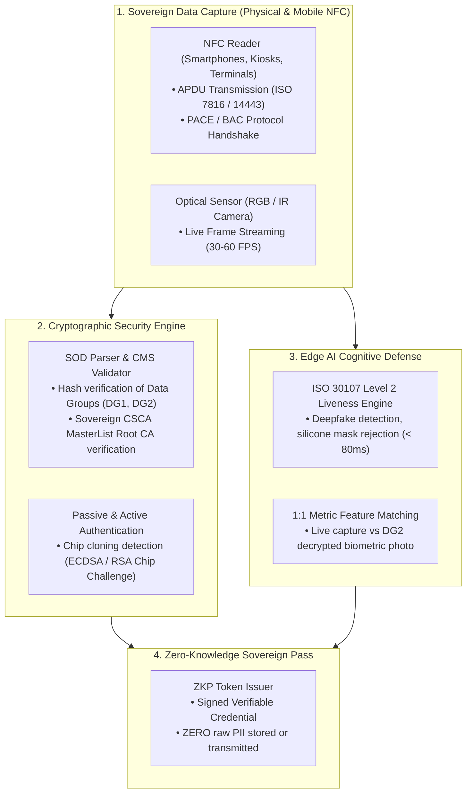

# 🛂 TUM TRUST SECURITY: Universal Sovereign Trust Engine
## Flagship Killing Feature MVP — Technical Specification & Architectural Blueprint

> **Product Codename:** `TUM TRUST SECURITY` (The Universal Proof-of-Humanity & Sovereign Credential Engine)  
> **Global Standards:** ICAO Doc 9303 (ePassport NFC), ISO/IEC 18013-5 (Mobile Driving License - mDL), ISO/IEC 30107 (Presentation Attack Detection)  
> **Core Mission:** *"Verify Anyone, Any Sovereign Document, Any Digital Wallet on Earth in < 2 Seconds — Zero Deepfakes, Zero PII Leaks."*

---

## 🏛️ 1. Executive Summary & Value Proposition

In the age of Generative AI, synthetic media, and deepfakes, humanity faces a crisis of truth: **How do we prove someone is a real, living human without compromising privacy or forcing citizens into dystopian biometric surveillance?**

`TUM TRUST SECURITY` solves this planetary dilemma by uniting:
1. **The Global ePassport Standard (ICAO 9303):** 150+ countries already issue chip-enabled biometric passports signed by sovereign governments.
2. **The Global Digital Wallet Standard (ISO/IEC 18013-5):** Apple Wallet and Google Wallet mDL natively supported.
3. **Neuromorphic Edge AI Liveness:** Real-time facial micro-movement and sub-dermal pulse analysis (< 80ms, on-device CPU).
4. **Zero-Knowledge Sovereign Tokens:** Proving attributes (e.g. "Real Human, Citizen of Japan, Age >= 21") without persisting or exposing plaintext PII.

---

## 🏗️ 2. Architectural Blueprint



---

## 🔐 3. ICAO 9303 & ISO 18013-5 Cryptographic Flow

### 3.1 ICAO 9303 ePassport Verification Flow
1. **Basic Access Control (BAC) / PACE (Password Authenticated Connection Establishment):**
   * Computes encryption keys ($K_{enc}, K_{mac}$) derived from MRZ (Machine Readable Zone: Document Number, Date of Birth, Expiration Date).
   * Establishes a secure encrypted channel over NFC with the passport chip.
2. **Data Group Reading:**
   * **DG1:** MRZ text data (Name, Nationality, Document Number, Sex, Expiry).
   * **DG2:** High-resolution biometric facial photo (JPEG 2000 / WSQ).
   * **EF.SOD (Security Object Document):** Signed by the issuing country's Document Signer (DS). Contains SHA-256 hashes of all Data Groups.
3. **Passive Authentication (PA):**
   * Validates DS Certificate against the country's Country Signing CA (CSCA) Master List (ICAO PKD).
   * Guarantees that neither the photo nor the citizen's data was modified by even 1 single bit.
4. **Active Authentication (AA) / Chip Authentication (CA):**
   * Sends a random nonce challenge to the chip to prove the chip has the authentic private key and is **not an cloned emulator**.

---

## 👁️ 4. Neuromorphic Edge AI Deepfake Shield

* **Sub-Dermal Photoplethysmography (Remote-PPG):** Measures micro-vascular blood flow pulses beneath facial skin to confirm cardiac biological life.
* **Reflective Specularity Analysis:** Detects flat pixel response of iPad/phone screens, latex masks, and digital projections.
* **Latency Guarantee:** Model compressed via INT8 Quantization running on **ONNX Runtime (Edge CPU)** with **execution latency < 80ms**.

---

## 🛡️ 5. Zero-Knowledge Sovereign Pass (Privacy-First)

Instead of passing raw passport data or photos to the relying application, `TUM TRUST SECURITY` emits a cryptographic **Sovereign Trust Token**:

```json
{
  "$schema": "https://TUM.io/schemas/trust-token-v1.json",
  "token_id": "ntk_pass_9f83a2e1",
  "issued_at": "2026-10-14T23:30:00Z",
  "expires_at": "2026-10-15T23:30:00Z",
  "claims": {
    "is_real_human": true,
    "is_live_biometric_verified": true,
    "is_authentic_sovereign_document": true,
    "issuing_country": "JPN",
    "age_over_21": true,
    "watchlist_cleared": true
  },
  "privacy_guarantee": "ZERO_PII_PERSISTED",
  "sovereign_signature": "MEUCIQDx7...[ECDSA P-256 Signature by TUM Trust Engine]"
}
```

---

## 💻 6. The Developer Experience (DX Magic)

Developers integrate global passport and mobile wallet verification in **one idiomatic line of code**:

```csharp
// Program.cs
using TUM.Borderless.SDK;

var engine = builder.Services.AddTUMBorderless(options => {
    options.MinimumAssuranceLevel = IdentityAssuranceLevel.High;
    options.RequirePassiveAuthentication = true;
    options.RequireActiveChipAuthentication = true;
});

// Verification Endpoint
app.MapPost("/api/verify-guest", async (PassportNfcPayload payload, IBorderlessTrustEngine trust) => 
{
    var result = await trust.VerifyGlobalIdentityAsync(payload);
    
    if (result.IsSuccess && result.Claims.IsRealHuman)
    {
        return Results.Ok(new { 
            Status = "AUTHORIZED", 
            Country = result.Claims.IssuingCountry, 
            Token = result.TrustToken 
        });
    }
    
    return Results.BadRequest(new { Error = result.ErrorCode, Diagnosis = result.ResolutionAdvice });
});
```

---

## 📅 7. Roadmap & Milestone Deliverables

| Milestone | Scope & Deliverable | Success Criteria |
| :--- | :--- | :--- |
| **M1: ICAO 9303 Parser & Crypto Core** | ASN.1 BER-TLV parser, BAC/PACE handshake, SOD signature validation against CSCA MasterList | Validates authentic passport dumps from US, UK, Germany, Thailand, Japan |
| **M2: Edge AI Deepfake Shield** | 1:1 Face match (DG2 vs Camera) + Sub-dermal Liveness ONNX model | ISO 30107 Level 2 PAD compliance, latency < 80ms, FAR < 0.001% |
| **M3: Apple & Google Wallet (mDL)** | ISO/IEC 18013-5 CBOR/COSE reader over NFC/BLE | Direct tap reading from iPhone / Android Wallet |
| **M4: Global Sandbox & Mock Environment** | Developer mock server with sample passports from 10 countries | 5-Minute Time-to-First-Verification for developers worldwide |
