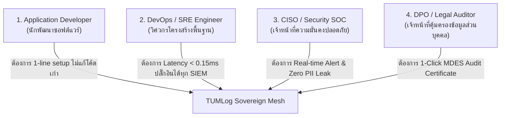

# TUMLog: User Requirement Specification (URS)
**Document Reference:** TUM-LOG-URS-2026-V1.0  
**Classification:** **PUBLIC / CLIENT-FACING (เผยแพร่ให้ลูกค้าได้)**  
**Target Audience:** Chief Information Security Officers (CISO), Data Protection Officers (DPO), Legal & Compliance Officers, Enterprise IT Procurement  
**Product:** TUMLog — Sovereign Application Compliance & Threat Defense Mesh (*Powered by TUM*)  
**Version:** 1.0.0  

---

## 1. วัตถุประสงค์และขอบเขต (Purpose & Scope)

เอกสารฉบับนี้กำหนดความต้องการในมุมมองของผู้ใช้งาน (User Requirements) สำหรับผลิตภัณฑ์ **TUMLog** เพื่อแก้ไขปัญหาคอขวด (Pain Points) ที่เกิดขึ้นจริงในองค์กรธุรกิจและทีมพัฒนาซอฟต์แวร์ ได้แก่:
1. การปฏิบัติตาม **พระราชบัญญัติว่าด้วยการกระทำความผิดเกี่ยวกับคอมพิวเตอร์ พ.ศ. 2560 มาตรา 26**
2. การปฏิบัติตาม **พระราชบัญญัติคุ้มครองข้อมูลส่วนบุคคล พ.ศ. 2562 (PDPA)** และ **GDPR**
3. การสอดคล้องตามมาตรฐานความมั่นคงปลอดภัยสากล **ISO/IEC 27001:2022 (Annex A.12.4)**
4. การขจัดความสับสนของนักพัฒนาในระบบ Legacy เกี่ยวกับตำแหน่งการวางคำสั่งบันทึก Log
5. การลดต้นทุนค่าใช้จ่ายในการจัดเก็บ Log บนคลาวด์สาธารณะ (Datadog, Splunk, CloudWatch) ที่คิดค่าบริการตามปริมาณกิกะไบต์ (GB) สูงเกินจริง

---

## 2. กลุ่มผู้ใช้งานหลักและบทบาท (User Personas)

### 2.1 Persona 1: Application Developer (นักพัฒนาซอฟต์แวร์)
- **Pain Point:** เขียนโค้ดในโปรเจกต์ที่ซับซ้อน (Spaghetti Code) มีหลายภาษา ไม่รู้จะวางคำสั่ง Log ไว้ที่ Controller, Service หรือ Repository วางแล้วโค้ดรก เกิดบั๊ก และกระทบความเร็วของระบบ
- **ความต้องการ:** ต้องการระบบ Log ที่ **"ติดเพียง 1 บรรทัด (Zero-Touch Middleware)"** แล้วสามารถดักจับและบันทึกทุก Endpoint อัตโนมัติ โดยไม่ต้องแก้ไขโค้ด Business Logic เดิม

### 2.2 Persona 2: DevOps & Platform Engineer (วิศวกรโครงสร้างพื้นฐาน)
- **Pain Point:** โดนบิลค่า Ingestion Log จาก Cloud ผู้ให้บริการหลักหมื่นถึงหลักแสนบาทต่อเดือน และระบบ Log หน่วงเวลาของ API
- **ความต้องการ:** ระบบต้องมีความเร็วสูงมาก (< 0.15ms Latency), บริโภคทรัพยากรต่ำ, ส่ง Log ไปยังปลายทางได้หลากหลาย (Local WORM, Syslog RFC 5424, OpenSearch, S3) และไม่มีค่าธรรมเนียมคิดตาม GB

### 2.3 Persona 3: CISO & Security Operations (เจ้าหน้าที่ SOC)
- **Pain Point:** ข้อมูล Log ในอดีตมักเป็น Plaintext ทำให้ข้อมูลบัตรประชาชนหรือบัตรเครดิตหลุดไปใน Log หรือมี Hacker พยายามเจาะระบบแต่ไม่มีการแจ้งเตือนแบบทันท่วงที
- **ความต้องการ:** ระบบต้องตรวจจับและบล็อกการโจมตี (OWASP Top 10) แบบ Real-time และต้องสแกน **ทั้งขาเข้าและขาออก** ป้องกันฐานข้อมูลพ่น Error หรือ Stack trace ออกไปหาผู้ใช้งานภายนอก

### 2.4 Persona 4: Data Protection Officer (DPO) & ผู้ตรวจประเมิน
- **Pain Point:** เมื่อเจ้าหน้าที่กระทรวงดิจิทัลเพื่อเศรษฐกิจและสังคม (MDES) หรือผู้ตรวจ ISO 27001 เข้าตรวจ การรวบรวมหลักฐานและพิสูจน์ว่า Log ไม่ถูกแก้ไขทำได้ยากมาก
- **ความต้องการ:** ต้องการปุ่ม **"1-Click Compliance Audit Certificate"** ที่มีหลักฐานทางคณิตศาสตร์ (SHA-256 Merkle Chain) และการอ้างอิงเวลาที่ถูกต้องตามกฎหมาย (NTP Stratum 1) ยืนยันได้ทันที

---

## 3. ความต้องการเชิงฟังก์ชันของผู้ใช้ (User Functional Requirements)

### UFR-01: การจัดเก็บตาม พรบ. คอมพิวเตอร์ พ.ศ. 2560 มาตรา 26
- **UFR-01.1:** ระบบต้องจัดเก็บ Log จราจรทางคอมพิวเตอร์และ Log ระดับ Application ไว้อย่างน้อย **90 วัน** (นโยบาย WORM: Write Once Read Many)
- **UFR-01.2:** เวลาของทุก Log Entry ต้องเทียบตรงกับเวลาอ้างอิงทางการ (**NTP Stratum 1: `time.navy.mi.th`** ของกองทัพเรือไทย) คลาดเคลื่อนไม่เกินเกณฑ์มาตรฐาน
- **UFR-01.3:** ระบบต้องมีกลไกทางคณิตศาสตร์พิสูจน์ได้ว่า Log ไม่ถูกแก้ไข แทรก หรือลบย้อนหลัง (Cryptographic Chain of Custody)

### UFR-02: การคัดแยกและลบข้อมูลส่วนบุคคล (PDPA & GDPR Zero PII Leak)
- **UFR-02.1:** ระบบต้องตรวจจับ **เลขประจำตัวประชาชนไทย 13 หลัก** ด้วยสูตร Modulo-11 Checksum และแปลงเป็น `1-XXXX-XXXXX-XX-1` โดยต้องไม่ Mask ตัวเลขสุ่ม 13 หลักที่ไม่ใช่เลขบัตรประชาชน
- **UFR-02.2:** ระบบต้องตรวจจับ **หมายเลขบัตรเครดิต/เดบิต (PAN)** ด้วยสูตร Luhn Algorithm และแปลงเป็น `4111-XXXX-XXXX-1111`
- **UFR-02.3:** ระบบต้องลบ **JWT Token (`Bearer eyJ...`)**, รหัสผ่าน, และ API Keys ออกจาก Log ก่อนจัดเก็บลงดิสก์ทุกครั้ง 100%

### UFR-03: การตรวจจับภัยคุกคามสองทิศทาง (Inbound & Outbound Defense)
- **UFR-03.1:** ระบบต้องสแกน Request ขาเข้าเพื่อตรวจจับ SQL Injection, XSS, Path Traversal, และ Command Injection
- **UFR-03.2:** ระบบต้องสแกน Response ขาออกเพื่อดักจับการเผลอส่งข้อมูล PII, การพ่น Database Syntax Error, และ Stack Trace ออกสู่ภายนอก
- **UFR-03.3:** ผู้ดูแลระบบต้องสามารถเลือกโหมดความปลอดภัยได้ระหว่าง **`Smooth (AuditOnly)`** (ตรวจจับและ Sanitize นุ่มนวล ไม่ขัดขวาง User) หรือ **`ActiveBlock`** (ตัดสายด้วย HTTP 403 Forbidden ทันที)

### UFR-04: แผนผังเส้นทางข้อมูลส่วนบุคคล (Endpoint PII Data Flow Matrix)
- **UFR-04.1:** ระบบต้องขึ้นทะเบียน API Endpoints ทั้งหมดในระบบโดยอัตโนมัติเมื่อมีทราฟฟิกวิ่งผ่าน
- **UFR-04.2:** ระบบต้องระบุได้ว่า Route ใดมีข้อมูลส่วนบุคคลวิ่งเข้า (Inbound) หรือวิ่งออก (Outbound) และคำนวณระดับความเสี่ยง (`Critical`, `High`, `Medium`, `Low`) ให้อัตโนมัติ

---

## 4. ความต้องการเชิงคุณภาพและประสิทธิภาพ (Non-Functional Requirements)

- **NFR-01 (Ultra-Low Latency):** การประมวลผลในระดับ HTTP Middleware ต้องใช้เวลาเฉลี่ย **ไม่เกิน 0.15 มิลลิวินาที** ต่อ Request
- **NFR-02 (Zero-Disruption):** หากระบบจัดเก็บ Log มีปัญหาขัดข้อง ต้องไม่ทำให้คำขอทางธุรกิจของผู้ใช้งาน (Business Request) ล้มเหลวหรือหยุดชะงัก
- **NFR-03 (Data Sovereignty):** ข้อมูล Log และดัชนีทั้งหมดต้องจัดเก็บบนโครงสร้างพื้นฐานขององค์กร (On-Premises / Private Cloud / Kiosk) ได้ 100% โดยไม่ต้องส่งข้อมูลข้ามแดน
