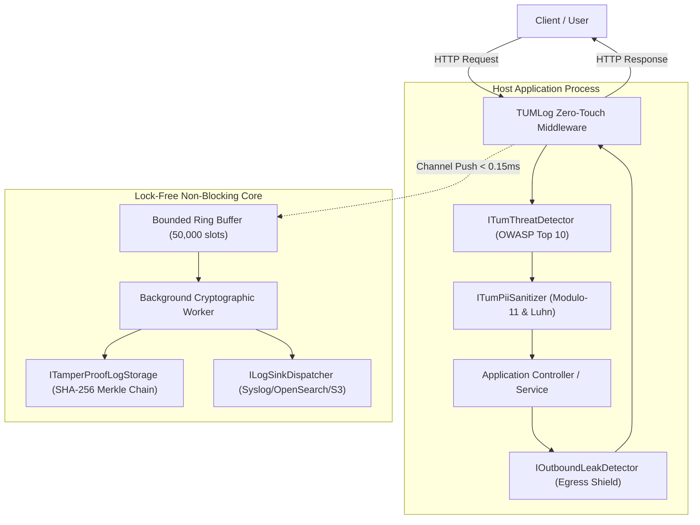

# TUMLog: System Requirement Specification (SRS)
**Document Reference:** TUM-LOG-SRS-2026-V1.0  
**Classification:** **COMMERCIAL / CLIENT-FACING WITH NDA (เปิดเผยแก่ลูกค้าภายใต้สัญญา NDA)**  
**Target Audience:** Enterprise Software Architects, Lead Security Engineers, DevSecOps Leads  
**Product:** TUMLog — Sovereign Application Compliance & Threat Defense Mesh (*Powered by TUM*)  
**Version:** 1.0.0  

---

## 1. บทนำและสถาปัตยกรรมระบบ (Introduction & Architecture)

ผลิตภัณฑ์ **TUMLog** ได้รับการออกแบบตามมาตรฐานสากล IEEE 830 เพื่อเป็นเอนจินจัดเก็บ Log ระดับ Application Layer ที่ผนวกรวมความมั่นคงปลอดภัยและการปฏิบัติตามกฎหมาย (Compliance-in-a-Box) เข้าด้วยกันอย่างสมบูรณ์แบบ

---

## 2. ข้อกำหนดสภาพแวดล้อมระบบ (System Environment & Compatibility)

- **Target Frameworks:** .NET 5.0, .NET 8.0 (LTS), .NET 10.0 (STS/LTS)
- **Supported Operating Systems:**
  - Linux (Ubuntu 20.04+, Debian 11+, RHEL 8+, Alpine 3.16+)
  - Windows Server (2016, 2019, 2022) & Windows 10/11
  - macOS (ARM64 / x64)
- **Deployment Topology:**
  - In-Process Embedded DLL (Zero Third-Party Dependencies)
  - Kubernetes Sidecar Agent (via Unix Domain Socket `/var/run/tumlog.sock`)
  - Standalone Docker Container

---

## 3. ข้อกำหนดทางเทคนิคเชิงลึก (Detailed Technical Specifications)

### 3.1 การตรวจสอบความถูกต้องของข้อมูลส่วนบุคคล (PII Algorithms)
1. **สูตรคำนวณเลขประจำตัวประชาชนไทย (Thai National ID Modulo-11):**
   กำหนดให้ $d_0, d_1, \dots, d_{11}$ เป็นเลข 12 หลักแรก:
   $$S = \sum_{i=0}^{11} d_i \times (13 - i)$$
   $$R = S \pmod{11}$$
   $$d_{12} = (11 - R) \pmod{10}$$
   ระบบจะทำ Mask เป็น `d0-XXXX-XXXXX-XX-d12` ก็ต่อเมื่อหลักที่ 13 ($d_{12}$) ตรงกับผลลัพธ์การคำนวณเท่านั้น

2. **สูตรคำนวณบัตรเครดิต/เดบิต (Luhn Algorithm Mod 10):**
   คำนวณตามมาตรฐาน ISO/IEC 7812:
   $$\sum_{i=1}^{n} f(d_i) \equiv 0 \pmod{10}$$
   เมื่อตัวเลขผ่านการคำนวณ ระบบจะ Mask ตัวเลขตรงกลาง และคงไว้เพียง 4 หลักแรกและ 4 หลักสุดท้าย (`4111-XXXX-XXXX-1111`)

### 3.2 กฎการตรวจจับภัยคุกคามขาเข้า (Inbound OWASP Signatures)
- **SQLi-01 (DDL/DML):** Regex `(?i)\b(union\s+select|select\s+.+\s+from|insert\s+into|delete\s+from|drop\s+table|update\s+.+\s+set)\b`
- **SQLi-02 (Boolean Bypass):** Regex `(?i)(?:'|\%27)\s*(?:or|and)\s*[\w\d]+(?:\s*=\s*[\w\d]+|--|#)`
- **SQLi-03 (Stored Proc):** Regex `(?i)\bexec(?:\s+|\+)+(?:xp_cmdshell|sp_executesql)\b`
- **XSS-01 (Script Tag):** Regex `(?i)<\s*script[^>]*>[\s\S]*?<\s*/\s*script\s*>`
- **XSS-02 (Event Handlers):** Regex `(?i)\bon(?:error|load|click|mouseover|focus|blur)\s*=`
- **Path-01 (Directory Escape):** Regex `(?:\.\./|\.\.\\|%2e%2e%2f|%2e%2e/|\.\.%2f)`
- **Path-02 (Sensitive Files):** Regex `(?i)(?:/etc/(?:passwd|shadow|hosts)|(?:c:|d:)[\\/](?:windows|winnt)[\\/](?:system32|win\.ini))`
- **Cmd-01 (Command Chaining):** Regex `(?i)(?:;|\||`|\$\()\s*(?:cat|ls|rm|chmod|whoami|curl|wget|powershell|cmd\.exe|nc|netcat)\b`

### 3.3 กฎการสกัดข้อมูลรั่วไหลขาออก (Outbound Leak Shields)
- **DB-Leak-01:** ตรวจจับ Error ฐานข้อมูล เช่น `Microsoft OLE DB Provider`, `SQL Server Native Client`, `syntax error at or near`, `ORA-00933`, `PostgreSQL query failed`, `SQLiteException`, `MySqlException` แทนที่ด้วย `[SEC_SUPPRESSED: Database internal error detail concealed]`
- **Stack-Leak-01:** ตรวจจับ Stack trace เช่น `at System.Data... in C:\`, `Traceback (most recent call last)`, `NullReferenceException` แทนที่ด้วย `[SEC_SUPPRESSED: Internal application stack trace concealed]`
- **Key-Leak-01:** ดักจับ `-----BEGIN (?:RSA )?PRIVATE KEY-----` แทนที่ด้วย `[SEC_BLOCKED: Cryptographic Private Key exfiltration prevented]`

### 3.4 โครงสร้างข้อมูลมาตรฐาน (Data Dictionary)
ทุก Log Entry ประกอบด้วยฟิลด์ตามมาตรฐานสากล:
- `LogId` (string, 32 char hex)
- `TimestampUtc` (ISO 8601 UTC with NTP offset)
- `CorrelationId` (W3C traceparent compliant, 32 char hex)
- `EventName` & `StandardAction` (string, max 32 chars e.g. `AUTH.LOGIN`, `DATA.READ`, `DATA.EXPORT`)
- `Category` (enum: `AuditTrail`, `SecurityThreat`, `PiiAccess`, `BusinessTransaction`, `SystemDiagnostic`, `LegalCompliance`)
- `Severity` (string: `Trace`, `Debug`, `Information`, `Warning`, `Error`, `Critical`)
- `ClientIp` (IPv4 / IPv6)
- `RequestPath` & `HttpMethod`
- `StatusCode` (int)
- `ExecutionDurationMs` (double)
- `PayloadSanitized` (string, PII-free)
- `TamperProofHash` (SHA-256 hex string)
- `PreviousEntryHash` (SHA-256 hex string)
- `MerkleRoot` (SHA-256 hex string)
- `ComplianceFlags` (flags: `ThaiComputerCrimeAct2560Sec26`, `ThaiPdpa`, `Gdpr`, `Iso27001`)

---

## 4. ปลายทางการจัดเก็บ (Supported Log Destination Sinks)

| Destination Sink | Protocol / Mechanism | Typical Latency | Primary Enterprise Use Case |
| :--- | :--- | :--- | :--- |
| **Local Sovereign WORM** | NVMe / SSD Append-Only File | < 0.05 ms | พรบ. คอมพิวเตอร์ ม.26 (จัดเก็บในเครื่อง 90 วัน) |
| **Syslog (RFC 5424)** | Mutual TLS v1.3 (TCP Port 6514) | 0.85 ms | ส่งเข้า SIEM องค์กร (Splunk, QRadar, Sentinel) |
| **Elastic / OpenSearch** | REST API Bulk JSON | 1.20 ms | การสืบค้นข้อความและวิเคราะห์ข้อมูลผ่าน Dashboard |
| **AWS S3 / MinIO** | Object Lock (Compliance Mode) | Batch (Async) | Cold Storage เก็บย้อนหลังระยะยาว 1-2 ปี |
