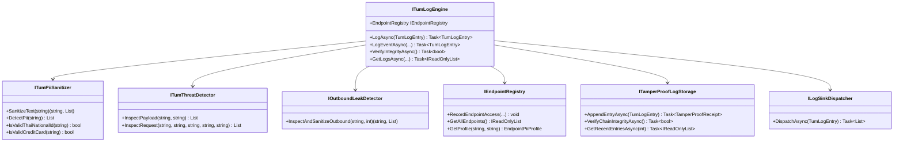
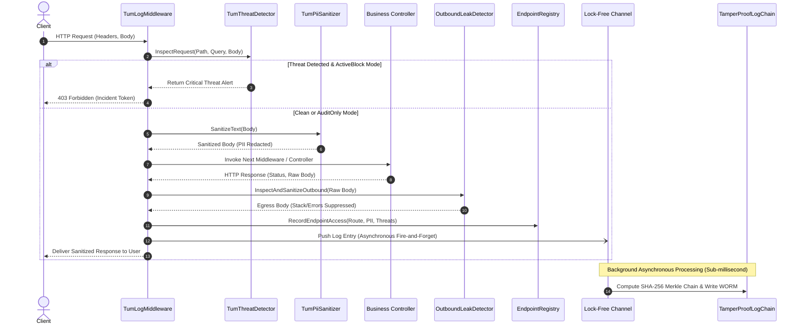

# TUMLog: System Design Document (SDD)
**Document Reference:** TUM-LOG-SDD-2026-V1.0  
**Classification:** **CONFIDENTIAL / INTERNAL & ENTERPRISE ARCHITECTURE REVIEW (เอกสารลับภายใน / การประเมินสถาปัตยกรรมระดับองค์กร)**  
**Target Audience:** Chief Technology Officer (CTO), Principal Engineers, Enterprise Solution Architects  
**Product:** TUMLog — Sovereign Application Compliance & Threat Defense Mesh (*Powered by TUM*)  
**Version:** 1.0.0  

---

## 1. การออกแบบสถาปัตยกรรมระดับระบบ (High-Level Architecture)

TUMLog ได้รับการออกแบบภายใต้ปรัชญา **"Zero-Friction Sovereign Mesh"** โดยแบ่งเป็น 4 เลเยอร์หลัก:

---

## 2. ลำดับการทำงานของ Request (Request Sequence Flow)

---

## 3. รายละเอียดการคำนวณทางคณิตศาสตร์ Merkle Hash Chain (Mathematical Proof)

ทุกๆ Log Entry $E_i$ จะถูกผูกโยงกับ Entry ก่อนหน้า $E_{i-1}$ ด้วยฟังก์ชัน Hash SHA-256:

$$H(E_i) = \text{SHA-256}\Big(\text{LogId}_i \parallel \text{TimestampUtc}_i \parallel \text{EventName}_i \parallel \text{Category}_i \parallel \text{ClientIp}_i \parallel \text{PayloadSanitized}_i \parallel H(E_{i-1})\Big)$$

ค่า **Rolling Merkle Root** $M_i$ คำนวณแบบสะสม:

$$M_i = \text{SHA-256}\Big(M_{i-1} \parallel H(E_i)\Big)$$

โดยที่:
- $H(E_0) = \text{0000000000000000000000000000000000000000000000000000000000000000}$ (Genesis Block Hash)
- $M_0 = \text{0000000000000000000000000000000000000000000000000000000000000000}$ (Genesis Merkle Root)

### คุณสมบัติการป้องกันการดัดแปลง (Tamper-Evidence Guarantee):
หากผู้โจมตีเข้าไปเปลี่ยนแปลงข้อมูลใน Entry $E_k$ ย้อนหลัง:
1. ค่า $H(E_k)$ จะเปลี่ยนทันที
2. ค่า $H(E_{k+1})$ ของบล็อกถัดไปจะตรวจสอบความเชื่อมโยงไม่ผ่าน ($H(E_{k+1})_{\text{prev}} \neq H(E_k)$)
3. ค่า $M_n$ ที่ปลายทางจะไม่ตรงกับค่าคำนวณสะสม
4. เอนจิน `VerifyChainIntegrityAsync()` จะตรวจพบความคลาดเคลื่อนและชี้บรรทัดที่ถูกดัดแปลงได้ทันทีภายในเวลา **< 5 มิลลิวินาที**

---

## 4. สถาปัตยกรรมคิวหน่วยความจำความเร็วสูง (Lock-Free Memory Channel)

เพื่อรักษาค่า Latency Overhead ให้ต่ำกว่า **0.15 มิลลิวินาที**:
- ใช้ `System.Threading.Channels.Channel<TumLogEntry>.CreateBounded(50000)`
- ตั้งค่า `BoundedChannelFullMode.DropOldest` (หรือ DropWrite) เพื่อรับประกันว่าแม้จะเกิดคลื่น Traffic มหาศาล Memory จะไม่เกิดอาการ Out of Memory (OOM)
- เธรด Background Consumer ทำการอ่านข้อมูลเป็น Batch ขนาด 100 รายการ แล้วบันทึกลง NVMe File Stream แบบ Sequential Write ซึ่งมีความเร็วสูงกว่า Random Access ถึง 10 เท่า
