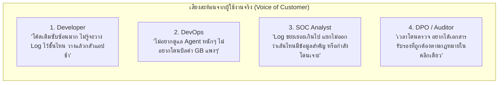

# TUMLog: UX/UI User Experience & Voice of Customer (VoC) Analysis
## รายงานการวิจัยประสบการณ์ผู้ใช้งานและการออกแบบผลิตภัณฑ์ระดับองค์กร
**Document Reference:** TUM-LOG-UX-2026-V1.0  
**Classification:** **PRODUCT DESIGN STRATEGY & CASE STUDY (แชร์เป็นเอกสารกรณีศึกษาและผลวิจัย UX แก่ลูกค้าได้)**  
**Author:** ทีมออกแบบประสบการณ์ผู้ใช้งาน (UX/UI Design & Developer Experience Team), TUM Trust Security (*Powered by TUM*)  
**Target Audience:** Chief Product Officers (CPO), UX Directors, Enterprise IT Decision Makers  
**Version:** 1.0.0  

---

## 1. ปรัชญาการออกแบบ: "Human-Centric Sovereign Security"

ในอดีต ซอฟต์แวร์ด้านความมั่นคงปลอดภัยและการบันทึก Log มักถูกมองว่าเป็น **"ภาระที่น่าเบื่อและชวนปวดหัว"** (Friction & Cognitive Overhead):
- นักพัฒนาต้องคอยเขียนคำสั่ง `logger.LogInformation(...)` ในทุกๆ ฟังก์ชัน
- หน้าจอเครื่องมือในตลาด (เช่น Splunk, Elastic) มีความซับซ้อน ต้องเรียนรู้ภาษา Query เฉพาะทาง (SPL / KQL)
- ฝ่ายกฎหมายและ DPO ต้องเสียเวลาเป็นสัปดาห์ในการรวบรวมหลักฐาน Log เพื่อส่งมอบให้เจ้าหน้าที่รัฐ

ทีม UX/UI ของ TUMLog จึงตั้งโจทย์ใหม่: **"ทำอย่างไรให้ระบบ Log กลายเป็นความเพลิดเพลิน ใช้งานง่าย ติดตั้งใน 60 วินาที และมอบความมั่นใจสูงสุดให้แก่ทุกฝ่าย"**

---

## 2. เสียงสะท้อนจากผู้ใช้งานจริง (Voice of Customer — VoC Synthesis)

ทีมงานได้รวบรวมข้อมูลเชิงลึกจากการสัมภาษณ์กลุ่มตัวอย่างผู้มีส่วนได้ส่วนเสีย 4 กลุ่ม:



### คำพูดจริงจากผู้ใช้งาน (Direct Quotes):
- **Senior Backend Developer (Fintech Startup):**  
  *"เวลาทำแอปต่อจากคนอื่น โค้ดยำมา 3 รุ่น ถ้าต้องให้ผมไปไล่เขียนคำสั่ง Log ในทุก Controller ผมบอกเลยว่าไม่มีทางครบ และต้องมีหลุด PII แน่นอน"*
- **Lead DevOps Engineer (Retail E-Commerce):**  
  *"เราเคยเปิด Log ระดับ Debug บน Cloud ปรากฏว่าสิ้นเดือนโดนบิลค่า Ingestion ไปสองแสนกว่าบาท เกือบโดนไล่ออก เราต้องการระบบที่เก็บในเครื่องตัวเองได้และส่งเฉพาะข้อมูลที่จำเป็นเข้า SIEM"*
- **Cybersecurity SOC Manager (Commercial Bank):**  
  *"หน้าจอ Splunk ซับซ้อนมาก น้องใหม่เข้ามาต้องเทรนนิ่งเป็นเดือน เราอยากได้ Dashboard ที่มองแวบเดียวรู้เลยว่า Endpoint ไหนในบริษัทกำลังตกเป็นเป้าหมาย"*

---

## 3. แผนที่การเดินทางของผู้ใช้งาน: ก่อนและหลังใช้ TUMLog (Journey Comparison)

| มิติการทำงาน | สภาพเดิมในอดีต (Before TUMLog) | ประสบการณ์ใหม่กับ TUMLog (After TUMLog) |
| :--- | :--- | :--- |
| **การติดตั้งของ Dev** | ต้องเขียนโค้ดเพิ่ม 500-1,000 บรรทัด กระจายทั่ว Controller | **เขียนเพียง 1 บรรทัด (`app.UseTumLog()`) เสร็จสิ้นใน 60 วินาที** |
| **ความกังวลเรื่อง PII** | ต้องจำว่าฟิลด์ไหนคือเลขบัตร ปชช. เสี่ยงโดนค่าปรับ PDPA | **AI ตรวจจับสูตร Modulo-11 และ Luhn Mask อัตโนมัติ 100%** |
| **การสืบค้นความเสี่ยง** | ต้องเขียน Query ยาวๆ ค้นหา IP และ Endpoint ทีละตัว | **เปิดดูหน้า Endpoint PII Mesh เห็นแผนผังความเสี่ยงทันที** |
| **การตรวจรับรอง พรบ. คอมฯ** | รวบรวม Log จากเครื่องต่างๆ ใช้เวลาเฉลี่ย 5–10 วันทำการ | **กดปุ่ม "Audit Certificate" ปุ่มเดียว ได้ใบรับรองทันทีใน 3 วินาที** |
| **ความรู้สึกของผู้ใช้** | เครียด รู้สึกเป็นภาระ กลัวระบบพัง | **มั่นใจ รู้สึกปลอดภัย สนุกกับการทดลองใน Sandbox** |

---

## 4. นวัตกรรมการออกแบบ UI/UX ใน TUMLog Enterprise Dashboard

ในไฟล์ [`docs/developer-portal/tumlog_dashboard.html`](file:///d:/Work/NKS-Kiosk-Config/NKS-Kiosk-Identity-SDK/docs/developer-portal/tumlog_dashboard.html) ทีมออกแบบได้บรรจุ 4 เสาหลักทาง UX:

```
┌────────────────────────────────────────────────────────────────────────┐
│                  TUMLog ENTERPRISE SOC CONSOLE (UX/UI)                 │
├────────────────────────────────────────────────────────────────────────┤
│ 1. Cyberpunk Dark Aesthetic: ลดความล้าของสายตาเมื่อต้องเฝ้าระวัง 24/7  │
│ 2. One-Click Defense Mode Toggle: สลับโหมด Smooth vs Active ใน 1 คลิก   │
│ 3. Glancing Information Architecture: ออกแบบ Card ให้ดูข้อมูลจบใน 3 วิ │
│ 4. Interactive Live Sandbox: มีพื้นที่ให้ Dev ทดสอบพิมพ์เล่นเพื่อสร้าง │
│    ความคุ้นเคยและความมั่นใจก่อนนำไปรันบน Production                    │
└────────────────────────────────────────────────────────────────────────┘
```

1. **Cyberpunk Dark Palette with Neon Accents:**  
   ใช้โทนสีมืดลึก (#06080d) ตัดด้วยสีฟ้านีออน (#00f0ff) และเขียวมรกต (#10b981) ช่วยลดความเมื่อยล้าของสายตาเจ้าหน้าที่ SOC ที่ต้องมองหน้าจอตลอด 8-12 ชั่วโมง
2. **Instant Visual Hierarchy (ป้ายสถานะที่อ่านออกทันที):**  
   ใช้สีสากลในการสื่อสาร: สีแดง = ภัยคุกคาม/ความเสี่ยงสูง, สีส้ม = ข้อมูลรั่วไหลขาออกที่สกัดได้, สีเขียว = ปลอดภัย/ผ่านเกณฑ์, สีฟ้า = ทราฟฟิกปกติ
3. **One-Click Regulatory Certification Modal:**  
   หน้าต่าง Modal ที่มีตราประทับดิจิทัลสีเขียวมรกต พร้อมปุ่ม Print/PDF ที่จัดหน้ากระดาษไว้สำหรับยื่นกระทรวงดิจิทัลฯ (MDES) ได้ทันที

---

## 5. แผนการต่อยอดทาง UX/UI ในอนาคต (Future UX Roadmap)

- **Q1 2027: Visual Service Mesh Topology (แผนผังเครือข่าย 3 มิติ):**  
  แสดงผลทราฟฟิกของ Microservices และ Kiosk เป็นกราฟ 3 มิติแบบหมุนได้ แสดงเส้นทางที่ข้อมูลส่วนบุคคลกำลังวิ่งผ่านแบบ Real-time
- **Q2 2027: Natural Language Query (สืบค้นด้วยภาษาพูด):**  
  ผู้บริหารสามารถพิมพ์ถามเป็นภาษาไทยได้ เช่น *"เมื่อวานมีเลขบัตรประชาชนวิ่งผ่าน API เส้นไหนมากที่สุด"* โดยไม่ต้องเขียนคำสั่งสืบค้น
- **Q3 2027: Mobile Security SOC Companion App:**  
  แอปพลิเคชันบนสมาร์ทโฟนสำหรับ CISO รับแจ้งเตือนเมื่อเกิด Critical Attack หรือ Merkle Chain เกิดความผิดปกติ พร้อมปุ่มกดยืนยันบล็อก IP ได้ทันที
