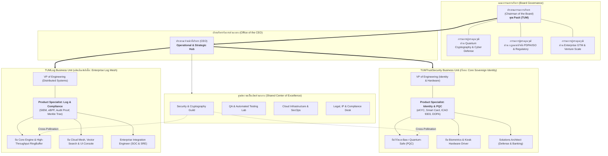

# TUM Trust Security & TUMLog: Corporate Organization & Operating Model
**Document Version:** 1.0.0  
**Effective Date:** 15 October 2026  
**Governance Level:** Board & Executive Committee  
**Approved by:** Chairman of the Board (Khun Pasit) & Chief Executive Officer (CEO)

---

## 1. Executive Summary & Strategic Re-alignment

### 1.1 The Imperative for Re-structuring
จากการเติบโตอย่างก้าวกระโดดและการพัฒนาผลิตภัณฑ์ใหม่ **TUMLog (Enterprise Compliance & Security Log Mesh)** ทำให้ทรัพยากรการพัฒนาและการสื่อสารเกิดการทับซ้อน (Context Mixing) ส่งผลให้ผลิตภัณฑ์หลักขององค์กรคือ **TUMTrustSecurity (Sovereign Identity, Biometrics & Quantum-Safe Identity Platform)** เกิดภาวะชะลอตัวในการพัฒนา

เพื่อแก้ปัญหาดังกล่าวอย่างถาวรและวางรากฐานสู่การเป็นองค์กรเทคโนโลยีความมั่นคงปลอดภัยไซเบอร์ระดับโลก (Tier-1 Cybersecurity Unicorn) องค์กรจึงกำหนดโครงสร้างการบริหารและผังบุคลากรใหม่ที่:
1. **แยกทีมปฏิบัติการ (Dedicated Business Units):** แบ่งแยกทีมงานระหว่าง **TUMTrustSecurity** และ **TUMLog** ออกจากกันอย่างเด็ดขาด ทั้งในแง่ Backlog, Sprints, และวิศวกรผู้รับผิดชอบ
2. **แต่งตั้ง Product Specialist ประจำแต่ละผลิตภัณฑ์:** เพื่อเป็นผู้นำทางเทคนิคและธุรกิจเฉพาะทางที่มีความเชี่ยวชาญลึกซึ้ง
3. **จัดตั้งกลไกการแลกเปลี่ยนความรู้ (Cross-Product Knowledge Sharing & Guilds):** เชื่อมโยงโนว์ฮาวด้านวิทยาการรหัสลับ (Cryptography) สถาปัตยกรรมระดับ Kernel และประสบการณ์ภาคสนามข้ามสายงาน
4. **ปรับเปลี่ยนโครงสร้างผู้นำสูงสุด (Executive & Board Governance):** คุณ Pasit ก้าวขึ้นดำรงตำแหน่ง **ประธานกรรมการบริหาร (Chairman of the Board)** ร่วมกับคณะกรรมการผู้ทรงคุณวุฒิเฉพาะทาง และแต่งตั้ง **Chief Executive Officer (CEO)** เป็นศูนย์กลางการบริหารและขับเคลื่อนงานปฏิบัติการทั้งหมดของทั้งสองผลิตภัณฑ์

---

## 2. โครงสร้างการกำกับดูแลและผังองค์กร (Organizational Hierarchy)



---

## 3. บทบาทหน้าที่และความรับผิดชอบ (Roles & Responsibilities)

### 3.1 คณะกรรมการบริหาร (Board of Directors)
- **Chairman of the Board (คุณ Pasit):**
  - กำหนดวิสัยทัศน์สูงสุด ทิศทางเชิงยุทธศาสตร์ระดับชาติและสากล
  - ตัดสินใจในเรื่องการลงทุน การเข้าซื้อกิจการ (M&A) และความร่วมมือเชิงยุทธศาสตร์ระดับรัฐบาล (G2G/G2B)
  - ประเมินผลการปฏิบัติงานของ CEO และควบคุมนโยบายบรรษัทภิบาล
- **คณะกรรมการผู้ทรงคุณวุฒิเฉพาะทาง (Subject-Matter Board Directors):**
  - *Board Director for Cryptography & Advanced Research:* ผู้ทรงคุณวุฒิด้าน PQC, Zero-Knowledge Proofs และคณิตศาสตร์รหัสลับ
  - *Board Director for Compliance & Governance:* ผู้ทรงคุณวุฒิด้านกฎหมายความมั่นคงไซเบอร์ พ.ร.บ.คอมพิวเตอร์ PDPA และมาตรฐานสากล (ISO 27001, SOC 2, Common Criteria)
  - *Board Director for Enterprise Scale & Investment:* ผู้เชี่ยวชาญการขยายตลาดซอฟต์แวร์ระดับสากลและเครือข่าย Venture Capital

### 3.2 ประธานเจ้าหน้าที่บริหาร (Chief Executive Officer - CEO)
- เป็น **ศูนย์กลางการขับเคลื่อนองค์กร (Operational & Strategic Hub)** ควบคุมการปฏิบัติงานประจำวันของบริษัททั้งหมด
- จัดสรรทรัพยากรบุคคล งบประมาณ และเวลา (Engineering Cadence) ไม่ให้เกิดการแย่งทรัพยากรกันระหว่างสองผลิตภัณฑ์
- กำกับดูแล Roadmap ให้ทั้ง TUMTrustSecurity และ TUMLog บรรลุตามเป้าหมาย (KPI & OKRs)
- รายงานผลการดำเนินงาน ปัญหาอุปสรรค และโอกาสทางธุรกิจต่อ Chairman of the Board ทุกสัปดาห์/เดือน

---

## 4. โครงสร้างหน่วยธุรกิจและ Product Specialists

### 4.1 หน่วยธุรกิจ TUMTrustSecurity (Flagship BU - Core Identity)
**พันธกิจ:** มุ่งเน้นการเป็นระบบยืนยันตัวตนระดับอธิปไตย (Sovereign Identity Platform), ตู้ Kiosk อัจฉริยะ, ePassport, การตรวจสอบใบหน้าและลายนิ้วมือทางชีวมิติ (Biometrics) และเทคโนโลยี Quantum-Safe Identity (PQC)

| ตำแหน่ง | บทบาทหน้าที่หลัก | ทักษะและความเชี่ยวชาญเฉพาะ |
| :--- | :--- | :--- |
| **Product Specialist: Identity, eKYC & PQC** | เป็นเจ้าของวิสัยทัศน์ผลิตภัณฑ์ Core Identity วิเคราะห์ความต้องการของธนาคาร, หน่วยงานราชการ (DOPA/ThaID), สายการบิน และตู้ Kiosk ออกแบบ Feature ด้านความปลอดภัย | ความรู้ลึกในมาตรฐาน ICAO 9303, ISO/IEC 19794, NIST PQC (FIPS 203 ML-KEM, FIPS 204 ML-DSA), CCID/PC/SC Smart Card Reader |
| **VP of Engineering (Identity & Hardware)** | บริหารจัดการทีมวิศวกร คุมกำหนดส่งมอบ Sprints และสถาปัตยกรรมระดับ Hardware/Driver | C#, C/C++, Embedded Systems, PKI, PCSC, Zero-Trust Architecture |
| **Core Cryptography Engineers** | พัฒนาและเพิ่มประสิทธิภาพไลบรารี PQC, Hardware Security Module (HSM), Safe Enclaves | Quantum-Resistant Algorithms, Side-Channel Attack Mitigation |
| **Kiosk & Biometrics Engineers** | พัฒนาระบบขับเคลื่อนอุปกรณ์ Kiosk (กล้อง, เครื่องอ่านพาสปอร์ต, เครื่องสแกนนิ้ว, Smart Card) | Windows Native APIs, Driver Interop, Image Processing, Anti-spoofing (Liveness Detection) |
| **Solutions Architect (Identity)** | ออกแบบระบบร่วมกับลูกค้าองค์กรขนาดใหญ่ (Banking, Border Control, Healthcare) | Enterprise Integration, Microservices, On-Prem Air-Gapped Deployments |

### 4.2 หน่วยธุรกิจ TUMLog (Enterprise Compliance & Log Mesh BU)
**พันธกิจ:** มุ่งเน้นการเป็นโครงข่ายจัดเก็บและวิเคราะห์ Log ระดับแอปพลิเคชันที่มีประสิทธิภาพสูง ตรวจจับภัยคุกคาม ปฏิบัติตามกฎหมายคอมพิวเตอร์และ PDPA และทำงานแบบ Zero-Code

| ตำแหน่ง | บทบาทหน้าที่หลัก | ทักษะและความเชี่ยวชาญเฉพาะ |
| :--- | :--- | :--- |
| **Product Specialist: Log, SIEM & Regulatory Compliance** | เป็นเจ้าของวิสัยทัศน์ผลิตภัณฑ์ TUMLog เจาะตลาดทีม SOC, DevOps, DPO และ CISO ทั่วประเทศและภูมิภาค กำหนดชุดตรวจจับและฟอร์แมต Log | ความรู้ลึกใน พ.ร.บ. คอมพิวเตอร์ ม.26, ประกาศกระทรวง ดีอี, PDPA, ISO 27001, OWASP Top 10, SIEM Integration (Splunk, Elastic, Sentinel) |
| **VP of Engineering (Distributed Systems)** | บริหารจัดการสถาปัตยกรรม Log Processing รองรับข้อมูลระดับล้าน Events/วินาที | Lock-free Data Structures, eBPF Kernel Tracing, Distributed Raft, High-Performance I/O |
| **Engine & Kernel Engineers** | ดูแล RingBuffer Channel, Merkle Hash Chain Tamper-Proofing, Ingestion Pipeline | Multi-threading, Low Latency C#, Memory Pooling, Linux Kernel eBPF |
| **Cloud & Analytics Engineers** | พัฒนา Dashboard, Vector Search Engine, SIEM Exporters, Multi-tenant SaaS | Real-time WebSocket, WebGL Canvas Graph, Time-series Database |
| **Enterprise Integration Engineer** | สนับสนุนลูกค้าในการติดตั้ง Middleware, Tuning Performance, แก้ปัญหา Production | DevOps, CI/CD, Kubernetes, ASP.NET Core Middleware Lifecycle |

---

## 5. กลไกการแลกเปลี่ยนองค์ความรู้ (Knowledge Sharing & Center of Excellence)

แม้ทั้งสองทีมจะถูกแบ่งแยก Backlog และทีมพัฒนาอย่างชัดเจนเพื่อโฟกัสในงานของตนเอง แต่บริษัทได้จัดตั้ง **3 กลไกหลัก** เพื่อให้เกิดการถ่ายทอดความรู้และความเป็นหนึ่งเดียวทางเทคโนโลยี:

### 5.1 Security & Cryptography Guild (การแลกเปลี่ยนวิทยาการรหัสลับ)
- **ความถี่:** จัดประชุมสัมมนาภายในทุก 2 สัปดาห์ (Bi-weekly Crypto Summit)
- **วัตถุประสงค์:**
  - ทีม TUMTrustSecurity นำเสนอพัฒนาการด้าน PQC และ Digital Signature มาตรฐานใหม่
  - ทีม TUMLog นำเสนอพัฒนาการด้าน Merkle Tree Hashing และ Zero-Knowledge Proofs สำหรับการยืนยันความถูกต้องของ Log
  - ทั้งสองทีมร่วมกันกำหนดมาตรฐานการเข้ารหัสของบริษัทให้เป็นไปในทิศทางเดียวกัน

### 5.2 Architecture Review Board (ARB - คณะกรรมการสถาปัตยกรรมซอฟต์แวร์)
- นำโดย CEO และ VP of Engineering ของทั้งสองฝ่าย
- ตรวจสอบการออกแบบระบบใหม่ (Design Review & RFC) ก่อนเริ่มพัฒนา เพื่อป้องกันการสร้างวงล้อซ้ำซ้อน (Don't Repeat Yourself - DRY at Enterprise Level)
- ส่งเสริมการดึง Core Utility หรือ Algorithm ที่ทดสอบจนเสถียรแล้วขึ้นเป็น Shared Internal Libraries

### 5.3 Customer Insights & Threat Intelligence Feed (การแลกเปลี่ยนสถานการณ์ตลาด)
- Product Specialists ของทั้งสองผลิตภัณฑ์จะแลกเปลี่ยนแนวโน้มความต้องการของลูกค้าทุกเดือน:
  - ตัวอย่าง: หากลูกค้าธนาคารของ TUMTrustSecurity ต้องการระบบ Audit Trail ที่ผ่านเกณฑ์ ธปท. ทีม TUMLog สามารถนำข้อมูลนี้ไปพัฒนา Custom Sink หรือ Rule Template มารองรับได้ทันที
  - ตัวอย่าง: หาก TUMLog ตรวจพบ Threat Pattern ใหม่จาก Application Layer ทีม TUMTrustSecurity สามารถนำไปเสริมใน Logic การยืนยันตัวตนแบบ Risk-Based Authentication ได้

---

## 6. แผนฟื้นฟูและเร่งรัดการพัฒนา TUMTrustSecurity ทันที (Immediate Action Plan)

เพื่อแก้ไขปัญหาที่ TUMTrustSecurity ชะลอตัว ทาง CEO กำหนดกรอบเวลาและเป้าหมายการเร่งงานดังนี้:

```
[ สัปดาห์ที่ 1 ] 
  ├── แยก Workspace/Branch และจัดสรรทีมงานถาวร (ห้ามสลับทีมพัฒนาไปมา)
  ├── มอบหมาย Backlog หลักของ TUMTrustSecurity ให้ทีม Core Identity เริ่ม Sprint ทันที
  └── Product Specialist เข้าประจำการและจัดทำ PRD (Product Requirement Document) ฉบับสมบูรณ์

[ สัปดาห์ที่ 2-3 ]
  ├── เร่งการพัฒนา TUMTrustSecurity PQC Engine สู่ระดับ Production-Ready (FIPS 203/204)
  ├── ทดสอบเชื่อมต่อ Hardware Smart Card Reader และเครื่องอ่านพาสปอร์ตจริงบน Testbed Kiosk
  └── ทำ Benchmark การตรวจสอบใบหน้าและ Anti-spoofing Biometrics ตามมาตรฐาน ISO/IEC 19794

[ สัปดาห์ที่ 4 ]
  ├── นำเสนอความก้าวหน้าของ TUMTrustSecurity ต่อ Chairman of the Board และคณะกรรมการ
  └── ปล่อย Release Version 1.5.0 สำหรับ TUMTrustSecurity ควบคู่ไปกับ TUMLog Version 1.0.0
```

---

## 7. สรุปคำมั่นสัญญาการบริหาร (CEO Operational Commitment)

ในฐานะ **Chief Executive Officer (CEO)** ผมขอให้คำมั่นต่อ **ท่านประธานกรรมการบริหาร (Chairman of the Board - คุณ Pasit)** และคณะกรรมการทุกท่านว่า:
1. การดำเนินงานประจำวันจะเป็นไปอย่างมีระเบียบวินัยและโปร่งใสสูงสุด
2. ผลิตภัณฑ์หลัก **TUMTrustSecurity** จะได้รับการฟื้นฟูอัตราเร่งของการพัฒนาสู่ระดับสูงสุดทันทีนับตั้งแต่วันนี้
3. ผลิตภัณฑ์ **TUMLog** จะเติบโตอย่างมั่นคงในฐานะโซลูชันระดับ Enterprise โดยมี Product Specialist และทีมงานของตนเองอย่างเต็มภาคภูมิ
4. พลังความร่วมมือระหว่างทีมจะแข็งแกร่งยิ่งขึ้นผ่าน Center of Excellence เพื่อนำพา **TUM Trust Security** สู่ยอดเขาของ Gartner ได้อย่างสง่างาม
