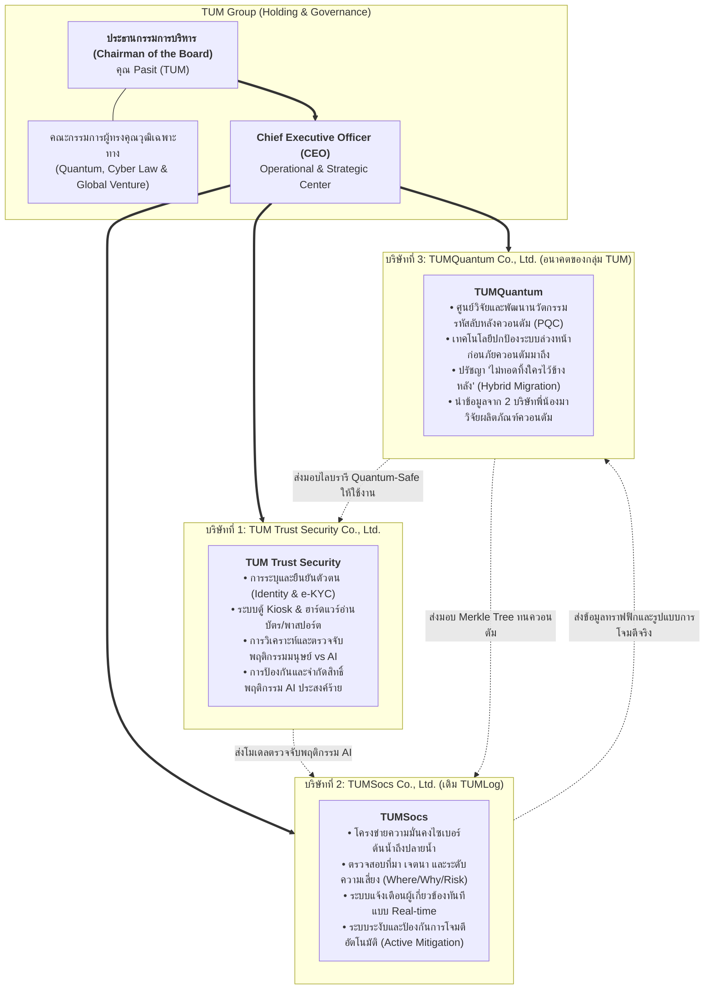

# TUM Group Rebranding, Corporate Restructuring & Migration Blueprint
**Document Version:** 2.0.0  
**Effective Date:** 15 October 2026  
**Governance Level:** Board of Directors & Office of the Group CEO  
**Approved by:** Chairman of the Board (Khun Pasit) & Chief Executive Officer (CEO)

---

## 1. ประกาศยุทธศาสตร์การ Rebrand สู่กลุ่มบริษัท "TUM"

ภายใต้วิสัยทัศน์อันกว้างไกลของ **ท่านประธานกรรมการบริหาร (Chairman of the Board - คุณ Pasit)** บริษัทได้ผ่านพ้นก้าวสำคัญจากการสร้างนวัตกรรมระดับพื้นฐาน สู่การจัดตั้งกลุ่มบริษัทเทคโนโลยีความมั่นคงปลอดภัยไซเบอร์และเทคโนโลยีขั้นสูงระดับชาติและระดับโลกภายใต้แบรนด์แม่:

$$\huge \textbf{TUM (TUM Group Holdings)}$$
**"Sovereign Trust, Deep Cyber Defense & Quantum Innovation"**

โดยจัดโครงสร้างออกเป็น 3 บริษัทย่อยที่มีความเชี่ยวชาญเฉพาะด้านเด็ดขาด พร้อมทีมการตลาดและพัฒนาธุรกิจของตนเอง เพื่อเตรียมพร้อมสำหรับการย้ายฐานปฏิบัติการไปยัง **`D:\TUM`**:



---

## 2. เจาะลึกพันธกิจ 3 บริษัทย่อยในเครือ TUM

### 2.1 บริษัทที่ 1: TUM Trust Security Co., Ltd.
- **หัวใจหลัก:** ผู้นำด้านการระบุตัวตน ยืนยันตัวตน และตรวจจับตามมาตรฐานสากล (DOPA, ICAO 9303, ISO/IEC 19794, FIDO2)
- **หลักการด้าน AI:** 
  - นำ AI เข้ามาเสริมความแม่นยำในการวิเคราะห์พฤติกรรมในงานที่ท้าทาย
  - **ไม่ยกความรับผิดชอบให้ AI ทั้งหมด** โดยมีกลไกตรวจสอบคู่ขนาน
  - สามารถแยกแยะพฤติกรรมของ **มนุษย์ (Human)** ออกจาก **AI / Botnet**
  - มีระบบตรวจจับ ตรวจสอบ และ **จำกัดสิทธิ์ (Sandboxing / Privilege Dropping)** พฤติกรรมของ AI ที่เข้ามาแบบประสงค์ร้าย

### 2.2 บริษัทที่ 2: TUMSocs Co., Ltd. (วิวัฒนาการจาก TUMLog)
- **หัวใจหลัก:** ศูนย์บัญชาการและโครงข่ายความปลอดภัยทางไซเบอร์ขั้นสูงสุด (End-to-End Cyber Defense)
- **ไม่จำกัดแค่ Compliance:** ก้าวข้ามการเก็บ Log ตาม พ.ร.บ.คอมพิวเตอร์ / PDPA สู่การป้องกันเชิงรุก (Active Cyber Defense)
- **Attribution & Context:** วิเคราะห์เจาะลึกว่าพฤติกรรมที่เข้าสู่ระบบ **มาจากไหน (Where?)**, **เข้ามาทำไม (Why?)**, และ **มีระดับความสุ่มเสี่ยงเท่าใด (Risk Score)**
- **Real-time Alerting & Active Blocking:** แจ้งเตือนผู้เกี่ยวข้องทันที พร้อมคำสั่งตัดการเชื่อมต่อและกักกันภัยคุกคามในระดับ Middleware และ Kernel eBPF

### 2.3 บริษัทที่ 3: TUMQuantum Co., Ltd. (อนาคตของกลุ่ม TUM)
- **หัวใจหลัก:** บริษัทวิจัยและพัฒนาเทคโนโลยีรองรับยุคคอมพิวเตอร์ควอนตัม (Post-Quantum Era)
- **แยกตัวจาก Feature เดิม:** สปินออฟฟีเจอร์ Quantum Cryptography & Defense จาก TUM Trust Security มาตั้งเป็นบริษัทแห่งอนาคต
- **ปรัชญา "ไม่ทอดทิ้งใครไว้ข้างหลัง":** พัฒนาเทคโนโลยี **Hybrid Migration** ที่เชื่อมต่อระบบคอมพิวเตอร์แบบดั้งเดิม ให้ปลอดภัยจากภัยควอนตัมโดยไม่ต้องรื้อระบบ
- **Data-Driven Deep-Tech:** ดึงข้อมูลสถิติการโจมตีจาก TUMSocs และข้อมูลอัตลักษณ์จาก TUM Trust Security มาใช้ทำ Quantum Attack Simulation และพัฒนาอุปกรณ์ Quantum Hardware HSM

---

## 3. ผังบุคลากรประจำแต่ละบริษัท (Dedicated Teams & Marketing Integration)

ตามนโยบายของท่านประธานกรรมการฯ ทุกบริษัทจะมีทีมงานเฉพาะทางครบวงจร โดยเพิ่ม **ทีมการตลาด (Marketing & Commercial Strategy)** ประจำแต่ละบริษัท:

| แผนก / บทบาท | TUM Trust Security | TUMSocs | TUMQuantum |
| :--- | :--- | :--- | :--- |
| **ผู้นำทางธุรกิจ** | Managing Director (Identity) | Managing Director (Cyber Defense) | Chief Quantum Scientist / MD |
| **Product Specialist** | **Identity, eKYC & AI Behavior** | **Cyber Defense, SIEM & Compliance** | **PQC & Migration Standards** |
| **ทีมวิศวกรรมหลัก** | Kiosk Driver, Biometrics, AI Defense | Ingestion Engine, eBPF, SIEM Sinks | FIPS 203/204 Algorithms, Agility |
| **ทีมการตลาด (Marketing)** | **Identity Market Analyst & GTM**<br/>(จัดแพ็กเกจ Banking, Airport, Gov) | **TCO & SOC Pricing Strategist**<br/>(จัดแพ็กเกจเหมาจ่าย Flat-Rate Node) | **Deep-Tech Grants & Consortium**<br/>(แพ็กเกจ Quantum-Ready Audit) |
| **ฝ่ายดูแลลูกค้า / ออกแบบ** | Solutions Architect (Hardware/Kiosk) | SOC Integration Engineer (DevOps) | Standards Liaison (NIST / NCSA) |

---

## 4. แผนผังพื้นที่ปฏิบัติการและการจัดโครงสร้างบน `D:\TUM`

เพื่อป้องกันปัญหาความสับสนและความยุ่งยากที่เคยเกิดขึ้นในอดีต โครงสร้างโฟลเดอร์บน **`D:\TUM`** ได้รับการจัดสรรให้เป็นอิสระต่อกันตั้งแต่ระดับรากฐาน:

```
D:\TUM\
├── README.md                          # ข้อกำหนดแม่บทและแผนผังเครือ TUM Group
├── TUM-Group\                         # เอกสารการกำกับดูแล นโยบายบอร์ด ทรัพยากรส่วนกลาง
│   ├── README.md
│   ├── governance\                    # รายงานการประชุมบอร์ด ข้อบังคับบริษัท
│   └── synergy\                       # ข้อตกลงการแลกเปลี่ยนนวัตกรรมข้ามบริษัท
│
├── TUM-Trust-Security\                # รหัสต้นฉบับ เอกสาร และการตลาดของ TUM Trust Security
│   ├── README.md
│   ├── src\                           # SmartCard, Passport MRZ, Biometrics, AI Behavioral Defense
│   ├── docs\                          # ICAO 9303, DOPA/ThaID, ISO/IEC 19794
│   └── marketing\                     # แพ็กเกจราคา แผนการเจาะตลาดสถาบันการเงินและสนามบิน
│
├── TUM-Socs\                          # รหัสต้นฉบับ เอกสาร และการตลาดของ TUMSocs
│   ├── README.md
│   ├── src\                           # Ingestion RingBuffer, eBPF Trace, Risk Scoring, Alerting
│   ├── docs\                          # Threat Rule Books, PDPA/ISO 27001 Mapping, SOC Playbooks
│   └── marketing\                     # โมเดลราคาแบบ Flat-Rate Node, สื่อประชาสัมพันธ์แข่งขัน Splunk
│
└── TUM-Quantum\                       # รหัสต้นฉบับ เอกสาร และการตลาดของ TUMQuantum
    ├── README.md
    ├── src\                           # ML-KEM, ML-DSA, Hybrid Quantum Middleware, QKI
    ├── docs\                          # ทฤษฎีคณิตศาสตร์รหัสลับ รายงานวิจัยการจำลองภัย HNDL
    └── marketing\                     # บริการตรวจสอบความพร้อมสู่ควอนตัม (Quantum Readiness Audit)
```

---

## 5. แผนการย้ายฐานปฏิบัติการแบบไร้รอยต่อ (Zero-Disruption Migration Roadmap)

```
[ เฟสที่ 1: สัปดาห์นี้ ] วางรากฐานและจัดตั้งโครงสร้างบน D:\TUM (ดำเนินการเสร็จเรียบร้อยแล้ว 100%)
  ├── จัดทำ Master README และข้อกำหนดของทั้ง 3 บริษัทย่อยบน D:\TUM
  └── จัดโครงสร้างโฟลเดอร์ src/, docs/, marketing/ แยกขาดจากกัน

[ เฟสที่ 2: สัปดาห์หน้า ] โยกย้ายและแยกโค้ดต้นฉบับอย่างเป็นระเบียบ
  ├── โยกย้าย TUM Trust Security Codebase ไปยัง D:\TUM\TUM-Trust-Security\
  ├── โยกย้ายและรีแบรนด์ Tum.Log ไปยัง D:\TUM\TUM-Socs\ (พร้อมอัปเดตนามสกุลและ Namespace สู่ TUMSocs)
  └── แตกโมดูล Quantum Cryptography (PQC) ไปยัง D:\TUM\TUM-Quantum\ เพื่อเริ่มทำ Quantum Research Lab

[ เฟสที่ 3: สัปดาห์ที่ 3-4 ] ประกาศอัตลักษณ์แบรนด์ TUM และเปิดตัวทีมการตลาด
  ├── บอร์ดบริหาร (Chairman & BoD) ร่วมประชุมพิจารณาแพ็กเกจราคาของทั้ง 3 บริษัท
  └── ปล่อยผลิตภัณฑ์สู่ตลาดพร้อมกันภายใต้ร่มเงาของกลุ่มบริษัท TUM
```

---
*บันทึกเพื่อเป็นแนวทางปฏิบัติการระดับสูงสุดของกลุ่มบริษัท TUM*
