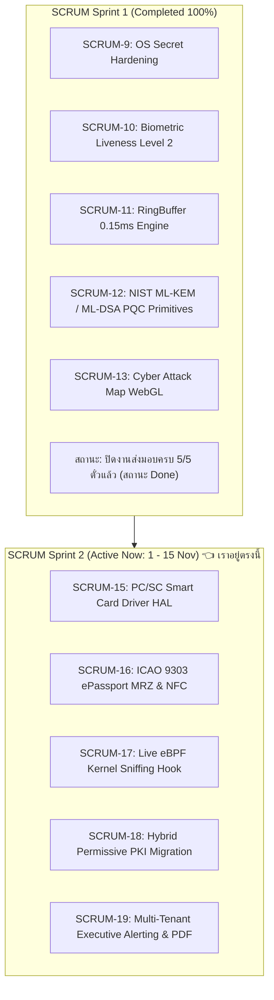
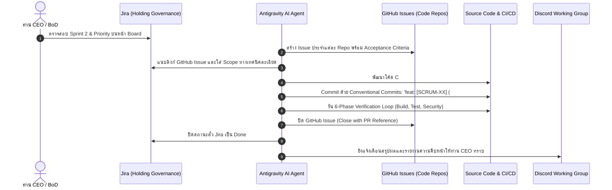

# TUM Group Holdings — Sprint 2 Executive Cockpit & Dual-Tracking Guide
## ประจำรอบการส่งมอบ: 1 พฤศจิกายน – 15 พฤศจิกายน 2026

> **สถานะ Sprint:** 🟢 **SCRUM Sprint 2 (Active / In-Progress)**  
> **เป้าหมายหลัก:** Physical Kiosk Driver HAL, ePassport NFC Biometrics, Kernel eBPF Telemetry, Hybrid PQC Adapter, and Executive Reporting Engine  
> **ระบบติดตามคู่ขนาน:** **Jira (Governance Tier)** + **GitHub Issues (Code Tier)**

---

## 1. คลายข้อสงสัยสถานะ Jira (Sprint Analysis from CEO Screenshots)

จากภาพหน้าจอ Jira ที่ท่าน CEO ส่งมาทั้ง 2 ภาพ ([Backlog] และ [Board]):

### ทำไมหน้าจอของท่าน CEO ถึงทำให้รู้สึกสับสน?
1. **เรากำลังอยู่ใน Sprint 2:** 
   - ที่มุมบนขวาของหน้า Board มีปุ่ม **`Complete sprint`** กำกับอยู่ข้าง `SCRUM Sprint 2 (1 Nov – 15 Nov)` แปลว่า **Sprint 2 กำลัง Active และเริ่มเดินเวลาแล้ว**
2. **ทำไมตั๋ว 5 ใบถึงยังอยู่ฝั่ง To Do ทั้งหมด?**
   - งานทั้ง 5 ใบ (`SCRUM-15` ถึง `SCRUM-19`) เพิ่งผ่านขั้นตอนการเตรียมสเปก (Backlog Refinement) และรอการหยิบเข้าพัฒนา (In Progress) 
3. **ทำไมถึงมองไม่เห็นงานที่เพิ่งทำเสร็จไป (เช่น R&D Charter, แยก Repos)?**
   - งานกลุ่มกลยุทธ์เครือ (`SCRUM-20` ถึง `SCRUM-26`) ที่เราทำในช่วงรอยต่อสปริ้นท์ ถูกบันทึกเป็น Task ระดับ Holding และปิดสถานะเป็น **Done** แล้ว เมื่อท่าน CEO เปิดหน้า Board ที่กรองเฉพาะ Sprint 2 จึงไม่เห็นงานที่ปิดไปแล้วครับ
4. **ทำไมเห็นกล่อง `SCRUM Sprint 1 (0 work items)` ว่างอยู่ข้างล่าง?**
   - เป็น Sprint Container ว่างเปล่าที่ยังไม่ได้กดยุบ (Delete/Close Empty Sprint) ในระบบ Jira ของ Atlassian ทำให้ดูเกะกะสายตา

---

## 2. เจาะลึก 5 ภารกิจหลักใน Sprint 2 (Sprint 2 Delivery Cockpit)

| # | รหัสตั๋ว Jira | GitHub Issue | บริษัทรับผิดชอบ (Pillar) | ขอบเขตงาน (Scope) | เกณฑ์การตรวจรับ (Acceptance Criteria) |
| :-: | :--- | :--- | :--- | :--- | :--- |
| 1 | [SCRUM-15](https://daywakler.atlassian.net/browse/SCRUM-15) | [#1 (tum-trust-security)](https://github.com/PasitTum/tum-trust-security/issues/1) | **01_TUM_Trust_Security** | **PC/SC Smart Card Driver HAL สำหรับตู้ Kiosk** | • อ่านบัตร ปชช. ครบถ้วน (เลข, ชื่อ, รูป) ในเวลา <800ms • รองรับ Contact & Contactless • APDU Fail Closed ปลอดภัย 100% |
| 2 | [SCRUM-16](https://daywakler.atlassian.net/browse/SCRUM-16) | [#2 (tum-trust-security)](https://github.com/PasitTum/tum-trust-security/issues/2) | **01_TUM_Trust_Security** | **ICAO 9303 ePassport MRZ & NFC Data Group Extraction** | • ถอดรหัส MRZ 2 แถว และ 3 แถวพร้อมเช็ค Checksum Modulo-10 • ดึงข้อมูล DG1 และ DG2 (ภาพใบหน้าไบโอเมตริก) • ความเร็ว <15ms ต่อเล่ม |
| 3 | [SCRUM-17](https://daywakler.atlassian.net/browse/SCRUM-17) | [#1 (tum-socs)](https://github.com/PasitTum/tum-socs/issues/1) | **02_TUM_Socs** | **Live eBPF Kernel Network Packet Sniffing & Telemetry** | • ฝัง eBPF Hook ดักจับ Traffic ในระดับ Kernel • ดักสแกนเลขบัตร ปชช. / บัตรเครดิต ก่อนหลุดออกนอกองค์กร (DPI) • Latency <0.15ms p99 ที่ 10,000 eps |
| 4 | [SCRUM-18](https://daywakler.atlassian.net/browse/SCRUM-18) | [#1 (tum-quantum)](https://github.com/PasitTum/tum-quantum/issues/1) | **03_TUM_Quantum** | **Hybrid Permissive Migration Adapter (Classical PKI + PQC)** | • รองรับ Dual-Signature (RSA/ECDSA + FIPS 204 ML-DSA) • ลูกค้าเก่าต่อได้ไม่พัง (Permissive Mode) • ตรวจสอบลายเซ็นคู่ <5ms |
| 5 | [SCRUM-19](https://daywakler.atlassian.net/browse/SCRUM-19) | [#1 (tum-central-director)](https://github.com/PasitTum/tum-central-director/issues/1) | **04_Central_Director** | **Executive Alerting & One-Click Audit Report (PDF/Excel)** | • ส่งออกรายงาน Audit Compliance (PDPA/ISO27001) ใน 1 คลิก • แจ้งเตือนด่วนผ่าน Discord/Slack Webhook <200ms • รองรับ Multi-Tenant แยกสิทธิ์ชัดเจน |

---

## 3. สถาปัตยกรรมกระบวนการทำงานใหม่: Jira + GitHub Issues Dual-Tracking

เพื่อให้การทำงานระหว่าง **ระดับผู้บริหาร (ท่าน CEO)** และ **ระดับวิศวกรรม (Engineering Repos)** สอดประสานกันอย่างไร้รอยต่อ:

---

## 4. แผนปฏิบัติการทันที (Immediate Execution Plan)

1. **Sprint 2 Task Execution:** เริ่มต้นพัฒนาฟีเจอร์แรกของ Sprint 2:
   - **`SCRUM-15` & GitHub Issue #1:** สร้าง Hardware Abstraction Layer สำหรับเครื่องอ่านบัตร PC/SC ใน `01_TUM_Trust_Security`
2. **Jira Board Synchronization:**
   - ย้ายสถานะ `SCRUM-15` จาก `To Do` -> `In Progress`
   - ปิดหรือลบ Empty Container `SCRUM Sprint 1` ออกจากหน้า Jira Backlog เพื่อความสะอาดตา
3. **Working Group Status Broadcast:**
   - รายงานสรุปสถานะการเริ่มต้น Sprint 2 ผ่าน Discord ให้คณะทำงานรับทราบอย่างเป็นทางการ
