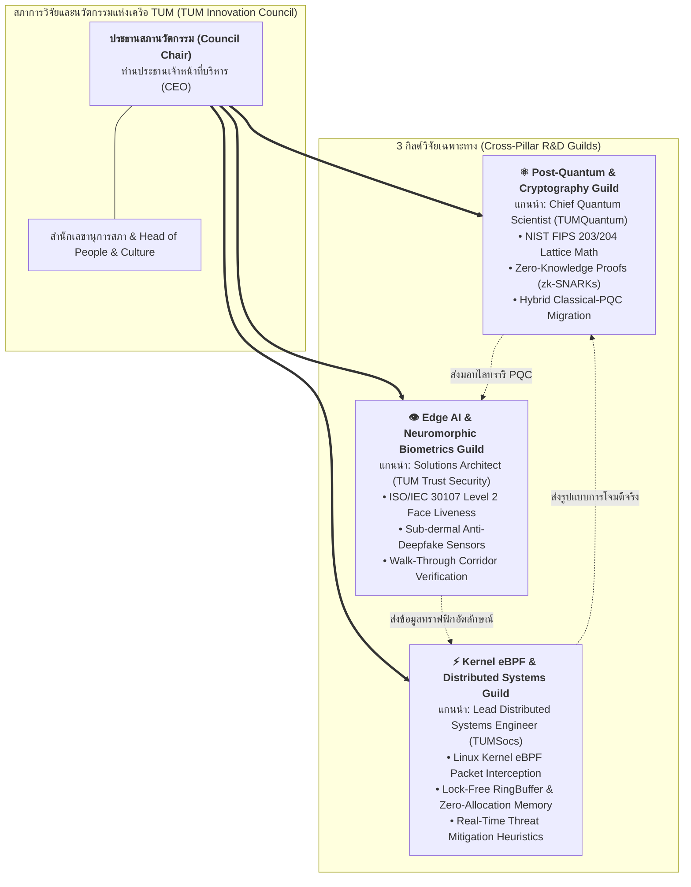

# 🏛️ ธรรมนูญสภาการวิจัยและนวัตกรรมแห่งเครือ TUM (TUM Innovation & Research Council Charter)
## (Governance Framework for Decentralized Embedded Labs & Cross-Pillar Guilds)

**เลขที่มติ:** TUM-BOD-RES-2026-11-003  
**วันที่มีผลบังคับใช้:** 1 พฤศจิกายน 2026  
**ระดับการกำกับดูแล:** สำนักประธานเจ้าหน้าที่บริหาร (Office of the CEO) & TUM Group Holdings  
**ผู้อนุมัติ:** ท่านประธานเจ้าหน้าที่บริหาร (Chief Executive Officer - CEO)  
**รูปแบบองค์กร:** **ทางเลือกที่ 3 — R&D Guild & Innovation Council (กระจายตัวแบบประสานพลัง)**

---

## 1. เจตนารมณ์และวิสัยทัศน์ (Founding Vision)

ตามมติเห็นชอบของท่าน CEO ประจำวันที่ 1 พฤศจิกายน 2026 กลุ่มบริษัท TUM ได้กำหนดทิศทางยุทธศาสตร์การวิจัยและพัฒนา (R&D) โดยยึดหลัก **"นักวิจัยต้องไม่แยกขาดจากหน้างานจริง และนวัตกรรมต้องไม่ขึ้นหิ้ง"**:

1. **ไม่รวมศูนย์จนเทอะทะ (No Bloated Silo):** นักวิจัยระดับหัวกะทิจะยังคงฝังตัว (Embedded) อยู่ในแต่ละบริษัทย่อย เพื่อสัมผัสทราฟฟิกจริง ภัยคุกคามจริง และโจทย์ธุรกิจจริงของลูกค้า
2. **ไม่ปล่อยให้ต่างคนต่างทำ (No Disconnected Chaos):** จัดตั้ง **สภาการวิจัยและนวัตกรรม (TUM Innovation & Research Council)** เป็นเวทีกลางเชื่อมต่อองค์ความรู้และจัดสรรงบประมาณวิจัยระดับ Moonshots
3. **ท่าน CEO เป็นประธานสูงสุด (CEO-Chaired Council):** ขับเคลื่อนทิศทางงานวิจัยที่ตอบโจทย์วิสัยทัศน์องค์กรโดยตรง

---

## 2. ผังโครงสร้างสภานวัตกรรมและกิลด์วิจัย (Council & Guilds Hierarchy)

---

## 3. ขอบเขตภารกิจของ 3 กิลด์วิจัย (Guild Mandates)

### ⚛️ กิลด์ที่ 1: Post-Quantum & Cryptography Guild (ดูแลโดย TUMQuantum)
- **พันธกิจหลัก:** พัฒนาและทดสอบอัลกอริทึมวิทยาการรหัสลับหลังควอนตัมให้สอดคล้องกับมาตรฐาน NIST FIPS และ NCSA
- **โจทย์วิจัยปี 2026-2027:**
  1. สร้าง **Hybrid Permissive Migration Adapter** สำหรับระบบธนาคารที่ยังใช้ RSA/ECDSA
  2. วิจัยการบีบอัด Public Key ของ ML-DSA Dilithium-44 เพื่อให้สามารถบรรจุลงในชิปบัตรประชาชนรุ่นใหม่ได้
  3. ร่วมมือกับกิลด์ Biometrics ทำระบบพิสูจน์ตัวตนแบบไม่เปิดเผยตัวตน (zk-Identity Proofs)

### 👁️ กิลด์ที่ 2: Edge AI & Neuromorphic Biometrics Guild (ดูแลโดย TUM Trust Security)
- **พันธกิจหลัก:** ยกระดับความแม่นยำในการพิสูจน์อัตลักษณ์ชีวมิติที่ขอบโครงข่าย (Edge Hardware / Kiosks)
- **โจทย์วิจัยปี 2026-2027:**
  1. พัฒนาโมเดลตรวจจับการสวมรอย Deepfake ระดับชีววิทยา (Sub-dermal Blood Flow & Liveness)
  2. ไดรเวอร์ฮาร์ดแวร์ตู้คีออสอัจฉริยะ (Self-Service Kiosk HAL) รองรับหนังสือเดินทางกว่า 150 ชาติ
  3. วิจัยระบบตรวจจับและตัดสิทธิ์พฤติกรรม AI ประสงค์ร้าย (Malicious Agent Privilege Dropping)

### ⚡ กิลด์ที่ 3: Kernel eBPF & Distributed Systems Guild (ดูแลโดย TUMSocs)
- **พันธกิจหลัก:** คิดค้นกลไกตรวจจับและระงับภัยคุกคามทางไซเบอร์ในระดับแกนกลางระบบปฏิบัติการ (Kernel Level)
- **โจทย์วิจัยปี 2026-2027:**
  1. โปรแกรมตรวจจับแพ็กเก็ตผ่าน eBPF ที่กินพลังงาน CPU ต่ำกว่า 1% บนทราฟฟิกระดับ 10 Gbps
  2. เครื่องยนต์ Merkle Hash Chain แบบเรียลไทม์เพื่อสร้างหลักฐานดิจิทัลที่ไม่อาจปฏิเสธได้ (Non-Repudiation)
  3. โหมดระงับการโจมตีอัตโนมัติ (Active Mitigation) ตัดการเชื่อมต่อ IP ประสงค์ร้ายภายในเสี้ยววินาที

---

## 4. จังหวะการประชุมและการดำเนินงาน (Operating Rhythm)

| การประชุม / พิธีกรรม | ความถี่ | ประธาน / ผู้เข้าร่วม | วาระและเป้าหมายหลัก |
| :--- | :---: | :--- | :--- |
| **สภานวัตกรรมประจำเดือน (Monthly Moonshot Assembly)** | เดือนละ 1 ครั้ง (45 นาที) | **ท่าน CEO (ประธาน)** • ผู้นำทั้ง 3 กิลด์วิจัย • Managing Directors ทั้ง 3 บริษัท | • สาธิตผลงานนวัตกรรม (15 นาที Demo) • ท่าน CEO ฟันธงปลดล็อกอุปสรรค/อนุมัติงบ (15 นาที Decision) • สรุปการยื่นจดสิทธิบัตรและทรัพย์สินทางปัญญา (15 นาที IP Review) |
| **Guild Hack & Paper Sync** | ทุก 2 สัปดาห์ (ในช่วง Cooldown) | ผู้นำแต่ละกิลด์ + วิศวกรวิจัย | • แลกเปลี่ยนโค้ด งานวิจัยทางวิชาการ และ CVE ล่าสุด • ทบทวน RFCs และสถาปัตยกรรมข้ามบริษัท |

---

## 5. การจัดสรรงบประมาณและทรัพย์สินทางปัญญา (Funding & IP Protocol)

1. **งบประมาณเวลา (10% Innovation Time):**
   - ภายใต้กรอบ **TUM Shape Up (รอบ 6 สัปดาห์ Build + 2 สัปดาห์ Cooldown)** กำหนดให้นักวิจัยในแต่ละกิลด์สามารถใช้เวลาช่วง 2 สัปดาห์ Cooldown ในการทำโครงการ R&D นอกกรอบได้อย่างอิสระ 100%
2. **ทรัพย์สินทางปัญญาและสิทธิบัตร (Patents & IP Ownership):**
   - สิทธิบัตร อัลกอริทึม และเอกสารวิจัยทั้งหมดเป็นกรรมสิทธิ์ของ **TUM Group Holdings Co., Ltd.**
   - บริษัทย่อยมีสิทธิ์นำไปใช้ในผลิตภัณฑ์เชิงพาณิชย์ของตนเองได้ทันทีโดยไม่มีค่าลิขสิทธิ์ภายในเครือ (Royalty-Free Group License)
3. **รางวัลนวัตกรรมดีเด่น (CEO Innovation Award):**
   - มีการมอบรางวัลผลงานวิจัยยอดเยี่ยมในงาน TUM Townhall ประจำไตรมาส สำหรับทีมที่สร้างผลงานตีพิมพ์หรือฟีเจอร์ที่สร้างมูลค่าสูงแก่เครือ

---

*ประกาศและเริ่มมีผลบังคับใช้ ณ วันที่ 1 พฤศจิกายน 2026*  
**อนุมัติโดย:** ท่านประธานเจ้าหน้าที่บริหาร (Chief Executive Officer - CEO)
