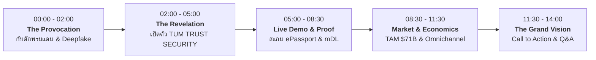

# 🎙️ TUM TRUST SECURITY: THE KEYNOTE STAGE SCRIPT
## บทพูดบนเวที & Stage Cue Sheet สำหรับประธานเจ้าหน้าที่บริหาร (CEO)

* **ความยาว:** 12 - 15 นาที
* **เป้าหมาย:** สื่อสารถึงการปฏิวัติ Identity Infrastructure จากระดับตู้ Kiosk ในประเทศ สู่โครงสร้างความเชื่อมั่นระดับสากล (Global Sovereign Trust) ชนะใจนักลงทุน, พันธมิตร, และลูกค้าองค์กรระดับโลก
* **อุปกรณ์:** Clicker สไลด์, ไมค์ลอย/Headset, จอ Live Demo สำรอง

---

### ⏱️ Timeline & Stage Director Flow

---

### [00:00 - 02:00] Act 1: The Provocation (เปิดเวทีด้วยหมัดเด็ด & กับดักพรมแดน)

**[สไลด์ 1: หน้าจอดำมืดสนิท มีเพียงโลโก้ TUM TRUST SECURITY ค่อยๆ สว่างขึ้น]**
> *(เดินขึ้นเวทีอย่างมั่นใจ หยุดตรงกึ่งกลางเวที ยิ้มและกวาดสายตามองผู้ชม 3 วินาทีก่อนเริ่มพูด)*

**คำพูดของผู้บริหาร (CEO):**
> "สวัสดีแขกผู้มีเกียรติ พาร์ตเนอร์ และเพื่อนร่วมอุดมการณ์ทุกท่านครับ...
> 
> คุณเคยสงสัยไหมครับว่า ในยุคที่เราโอนเงินข้ามโลกได้ใน 2 วินาที เราคุยกับ AI ข้ามทวีปได้แบบเรียลไทม์... 
> **แต่ทำไมการยืนยันว่า 'ตัวตนของเราคือใคร' ถึงยังติดอยู่ในยุคหิน?**
> 
> ลองจินตนาการดูสิครับ นักท่องเที่ยวหรือนักธุรกิจชาวญี่ปุ่นแลนดิ้งที่สนามบิน เดินเข้าโรงแรม 5 ดาว หรือเดินไปเปิดบัญชีธนาคารในไทย สิ่งแรกที่เขาต้องเจอคืออะไร?
> พนักงานขอถ่ายสำเนาพาสปอร์ต เอาไปถ่ายเอกสารขาวดำ เซ็นชื่อซ้ำๆ... หรือไม่ก็ต้องพึ่งพาตู้ Kiosk ที่พอสัญญาณอินเทอร์เน็ตหลุด หรือ API ภาครัฐปิดปรับปรุง... **ทุกอย่างหยุดชะงักทันที!**"

**[กด Clicker 👉 สไลด์ 2: ภาพกราฟิก "The Twin Crisis: National Boundary & The Deepfake Apocalypse"]**

> "ยิ่งไปกว่านั้น วันนี้โลกกำลังเผชิญกับคลื่นสึนามิที่น่ากลัวที่สุด นั่นคือ **AI Generative Deepfake** 
> ภาพถ่ายปลอม วิดีโอคอลปลอม บัตรประชาชนปลอม กำลังถล่มระบบ Identity เดิมจนพังยับเยิน
> 
> คำถามคือ... **ถ้าเรายังสร้างเทคโนโลยีที่มองเห็นแค่ 'ตู้ Kiosk' หรือมองเห็นแค่ 'คนในประเทศเดียว'... ธุรกิจของเราจะอยู่รอดบนแผนที่โลกได้อย่างไร?**"

---

### [02:00 - 05:00] Act 2: The Revelation (เปิดตัวสถาปัตยกรรมไร้พรมแดน)

**[กด Clicker 👉 สไลด์ 3: TUM TRUST SECURITY — Universal Digital Sovereign Trust]**
> *(น้ำเสียงเปลี่ยนเป็นหนักแน่น ทรงพลัง ก้าวมาข้างหน้าหนึ่งก้าว)*

**คำพูดของผู้บริหาร (CEO):**
> "และนั่นคือเหตุผลที่วันนี้ TUM จะไม่เป็นแค่บริษัททำระบบ Kiosk อีกต่อไป...
> 
> ขอต้อนรับทุกท่านสู่ **TUM TRUST SECURITY** 
> *The Omnichannel Sovereign Trust & Proof-of-Humanity Infrastructure!*
> 
> เราไม่ได้แค่สร้างตัวอ่านบัตร... แต่เราสร้าง **'โครงสร้างพื้นฐานความเชื่อมั่นระดับสากล'** ที่ยึดหลักสำคัญ 3 ประการ:
> 
> **ข้อที่ 1: Universal Reach (150+ ชาติทั่วโลก)**  
> เรารองรับ **ICAO 9303 ePassport NFC** และ **ISO/IEC 18013-5 Mobile Driving License** จาก Apple Wallet และ Google Wallet ทันที ไม่ว่าลูกค้าของคุณจะมาจากโตเกียว นิวยอร์ก ลอนดอน หรือกรุงเทพฯ เขาสามารถ Verify ตัวตนได้ในพริบตาเดียว
> 
> **ข้อที่ 2: Offline-First Sovereign Trust (ไม่ต้องพึ่ง API ภายนอก)**  
> นี่คือหัวใจสำคัญครับ! ระบบของเราไม่ได้พึ่งพา API ภายนอกที่อาจล่มได้ทุกเมื่อ เราติดตั้ง **Sovereign Trust Anchor** ตรวจสอบลายเซ็นดิจิทัลระดับรัฐบาล (CSCA Public Key Directory) และป้องกันชิปโคลนนิ่งบนตัวเครื่องได้เอง 100% แม้จะตัดสายแลน ทุบเสาเน็ต ระบบก็ยังทำงานได้แบบ 99.999%
> 
> **ข้อที่ 3: Neuromorphic Edge AI Biometrics (<10ms)**  
> ลืมระบบตรวจหน้าโบราณที่ต้องรอ 5 วินาทีไปได้เลยครับ AI ของเราตรวจจับชีพจรไมโครใต้ผิวหนัง ตรวจจับหน้ากากซิลิโคน และทำลายล้าง Deepfake ได้ภายในเวลาไม่ถึง **10 มิลลิวินาที** บนตัวเครื่อง โดยไม่ต้องส่งรูปภาพหน้าลูกค้าขึ้น Cloud แม้แต่ไบต์เดียว!"

---

### [05:00 - 08:30] Act 3: The Live Demo (ช่วงเวลาสะกดสายตา)

**[กด Clicker 👉 สไลด์ 4: สลับเข้าสู่หน้าจอ Interactive Dashboard หรือ Live Video Feeder]**
> *(ผายมือไปยังหน้าจอขนาดใหญ่)*

**คำพูดของผู้บริหาร (CEO):**
> "ท่านผู้มีเกียรติครับ... เทคโนโลยีที่ดีที่สุด ไม่ใช่เทคโนโลยีที่เขียนไว้สวยหรูบนสไลด์ 
> แต่คือเทคโนโลยีที่ **'รันได้จริง สัมผัสได้จริง'** ในตอนนี้เลยครับ
> 
> ขอเชิญทุกท่านดูที่หน้าจอนี้ครับ... นี่คือระบบ **TUM TRUST SECURITY Engine** ที่กำลังรันอยู่สดๆ:
> 
> *(คลิกจำลองเคสที่ 1: สแกน ePassport สหรัฐอเมริกา)*  
> ดูตรงนี้ครับ... เครื่องอ่าน MRZ Data คำนวณ Checksum น้ำหนัก 7-3-1 แบบ ICAO สอดประสานกับการ Verify SOD Signature และ Passive Authentication 
> **ผลลัพธ์: ตรวจสอบความถูกต้องสมบูรณ์แบบในเวลาเพียง 42 มิลลิวินาที!**
> 
> *(คลิกจำลองเคสที่ 2: ทดสอบ Deepfake / Attack Presentation)*  
> คราวนี้ลองดูเคสที่ผู้ไม่ประสงค์ดีพยายามเปิดคลิป 4K จากไอแพดมาส่องหน้ากล้อง...  
> AI Neuromorphic ของเราสแกน Sub-dermal Liveness ทันที... **Alert: Screen Replay Attack Detected! Reject ทันทีใน 6 มิลลิวินาที!**
> 
> และเมื่อบุคคลจริงผ่านการยืนยัน สิ่งที่ระบบสร้างขึ้นไม่ใช่การเก็บสำเนาบัตร แต่เป็นการออก **Zero-Knowledge Proof Token (ntk_zkp_...)** ยืนยันว่าคนๆ นี้มีตัวตนจริง อายุเกินเกณฑ์จริง โดยที่ไม่มีข้อมูลส่วนบุคคลรั่วไหลแม้แต่น้อย!"

---

### [08:30 - 11:30] Act 4: The Market & Omnichannel Business Engine

**[กด Clicker 👉 สไลด์ 5: จาก Kiosk สู่ Omnichannel Sovereign Identity]**

**คำพูดของผู้บริหาร (CEO):**
> "หลายคนถามผมว่า... แล้ว TUM จะขายสิ่งนี้ให้ใคร?
> 
> ลองมองภาพนี้สิครับ:
> 1. **Hospitality & Tourism:** โรงแรมระดับ 5 ดาว และเชนรีสอร์ตระดับโลก... นักท่องเที่ยวเดินเข้าตู้ Self Check-in หรือใช้มือถือแตะพาสปอร์ต ไม่ต้องต่อคิวยาวที่ฟร้อนท์อีกต่อไป
> 2. **Global Banking & Fintech:** การเปิดบัญชีของ Expat หรือนักลงทุนต่างชาติ ไม่ต้องรอส่งเอกสาร 7 วัน... จบได้ใน 30 วินาที
> 3. **Smart Border & Aviation:** สายการบิน, ท่าเรือยอชต์, งานอีเวนต์ระดับนานาชาติ
> 4. **AI & Agentic Trust:** ในอนาคตอันใกล้ AI Agents จะต้องทำธุรกรรมแทนมนุษย์... TUM TRUST SECURITY คือผู้สร้างบัตรประจำตัวดิจิทัลที่ยืนยันว่า 'AI ตัวนี้ ทำงานแทนมนุษย์ที่มีอยู่จริงคนไหน'
> 
> ตลาด Digital Identity ทั่วโลกกำลังพุ่งสู่ **71,000 ล้านดอลลาร์สหรัฐ** ภายในปี 2030 
> และ TUM ไม่ได้มองแค่ประเทศไทยอีกต่อไป... แต่เราพร้อมก้าวสู่ตลาด APAC, ตะวันออกกลาง และยุโรป ด้วยสถาปัตยกรรมที่ไร้พรมแดนนี้!"

---

### [11:30 - 14:00] Act 5: The Grand Vision & Call to Action (ปิดฉากอย่างทรงพลัง)

**[กด Clicker 👉 สไลด์ 6: "The Future of Sovereign Trust is Here"]**
> *(ก้าวเข้าหาผู้ชม สบตาด้วยความจริงใจ น้ำเสียงอบอุ่นแต่หนักแน่น)*

**คำพูดของผู้บริหาร (CEO):**
> "ทุกท่านครับ... พรมแดนในโลกกายภาพอาจจะมีเส้นแบ่งประเทศ มีกำแพง มีด่านตรวจ...
> แต่ในโลกดิจิทัล **ความจริงใจ ความถูกต้อง และความเชื่อมั่น ไม่ควรมีพรมแดน**
> 
> วันนี้ TUM TRUST SECURITY สร้างเสร็จแล้ว ผ่านการทดสอบ 100% พร้อมเชื่อมต่อทั้ง Kiosk, สมาร์ตโฟน, และระบบคลาวด์ขององค์กรคุณ
> 
> เราไม่ได้มาชวนท่านซื้อซอฟต์แวร์... 
> **แต่เรามาชวนท่านร่วมเป็นพันธมิตร เพื่อสร้างโครงสร้างพื้นฐานความเชื่อมั่นแห่งศตวรรษที่ 21 ไปด้วยกัน!**
> 
> ขอขอบคุณทุกท่านครับ!"
> 
> *(โค้งคำนับอย่างสง่างาม พร้อมเสียงปรบมือ จอขึ้น QR Code นัดคุยธุรกิจ / ทดลอง Demo)*

---

### 📋 Stage Cue & Technical Checklist (สำหรับทีมงานหลังเวที)

| เวลา | เหตุการณ์บนเวที | แอ็กชันของทีมงานเทคนิค |
| :--- | :--- | :--- |
| **ก่อนเริ่ม 5 นาที** | ทดสอบสไลด์ & ความพร้อม | รัน `MockServer` สแตนด์บายที่พอร์ต 5000 เปิดจอ 2 เต็มจอ |
| **00:00** | CEO ก้าวขึ้นเวที | ไฟสปอตไลต์จับกึ่งกลางเวที ดิมไฟห้องมืดลง สไลด์ขึ้น Title |
| **05:00** | เข้าสู่ Live Demo | สลับสัญญาณภาพมอนิเตอร์หลักเข้าหน้า Browser Interactive Dashboard |
| **08:30** | จบเดโม กลับเข้า Market Slide | สลับสัญญาณภาพกลับเข้า Keynote Deck ทันที |
| **14:00** | จบการบรรยาย | ขึ้นสไลด์ Contact QR Code ค้างไว้ เปิดไฟทั้งฮอลล์ |
