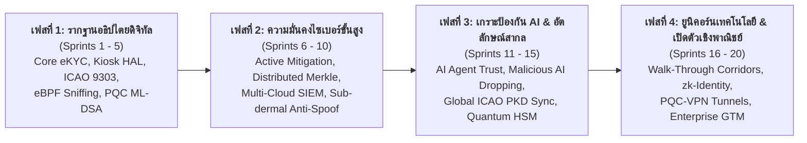

# 🗺️ TUM Group Holdings: 20-Sprint Master Strategic Execution Roadmap
## แผนยุทธศาสตร์ปฏิบัติการแบบไร้รอยต่อ 20 สปรินต์ (Sprint 1 ถึง Sprint 20)
**ระดับการกำกับดูแล:** คณะกรรมการบริหาร (Board of Directors) & สำนักประธานเจ้าหน้าที่บริหาร (Office of the CEO)  
**ผู้อนุมัติ:** ท่านประธานเจ้าหน้าที่บริหาร (Chief Executive Officer - CEO)  
**วันที่ประกาศ:** 1 พฤศจิกายน 2026  
**Jira Master Epic:** [`SCRUM-23`](https://daywakler.atlassian.net/browse/SCRUM-23)

---

## 1. วิสัยทัศน์และกรอบ 4 มหภาคยุทธศาสตร์ (The 4 Macro Phases)

แผนงาน 20 สปรินต์นี้ครอบคลุมการพัฒนาควบคู่กันของ **5 เสาหลักกลุ่มบริษัท TUM**:
1. `01_TUM_Trust_Security`: Sovereign Identity, e-KYC, Kiosks, Smart Cards & ICAO 9303
2. `02_TUM_Socs`: Full-Spectrum Cyber Defense, SIEM Telemetry & Tamper-Evident Ledger
3. `03_TUM_Quantum`: Post-Quantum Cryptography (NIST FIPS 203/204) & Hybrid Migration
4. `04_Central_Director`: Executive Dashboards, Real-Time WebGL Attack Map & HUD
5. `05_TUM_Group_Holdings`: Governance, OKRs, People & Culture, R&D Council & Working Groups

---

## 2. เจาะลึกรายละเอียดแผนปฏิบัติการ Sprint 1 ถึง Sprint 20

### 🟢 เฟสที่ 1: รากฐานอธิปไตยดิจิทัลและตู้คีออสบริการประชาชน (Sprints 1 - 5)

#### Sprint 1 (✅ เสร็จสิ้นสมบูรณ์ 100%): Sovereign Foundation & Secret Hardening
- **Trust:** ระบบยืนยันตัวตน DOPA & ThaID 20 Scopes พร้อม OS Environment Secret Fallback
- **Socs:** Tamper-Evident Log Chain พร้อมระบบปกป้องข้อมูลส่วนบุคคล PII Vault
- **Quantum:** ตัวจำลองอัลกอริทึมแลตทิซเบื้องต้น
- **Director:** เชื่อมต่อ Webhook แจ้งเตือนสถานะความปลอดภัยสู่ Discord
- **Holdings:** สไลด์นำเสนอ Working Group Sprint 1, ผังองค์กรใหม่, 125/125 Tests Passing

#### Sprint 2 (⚡ กำลังดำเนินการ): Kiosk Smart Card HAL & Live Kernel Telemetry
- **Trust (`SCRUM-15`):** ไดรเวอร์ฮาร์ดแวร์ตู้คีออส PC/SC Smart Card Driver Hardware Abstraction Layer
- **Trust (`SCRUM-16`):** ตัวถอดรหัสพาสปอร์ตสากล ICAO 9303 MRZ Parser & NFC Data Groups Inspection
- **Socs (`SCRUM-17`):** ระบบดักจับแพ็กเก็ตเครือข่ายระดับเคอร์เนล Live eBPF Kernel Network Packet Sniffing
- **Quantum (`SCRUM-18`):** ตัวแปลงระบบเดิมสู่ควอนตัม Hybrid Permissive Migration Adapter for Classical PKI
- **Director (`SCRUM-19`):** ระบบแจ้งเตือนผู้บริหาร Multi-Tenant Executive Alerting & One-Click Audit Export
- **Holdings:** สไลด์ Working Group Sprint 2 และการสัมภาษณ์รอบ Simulation ของผู้สมัคร Scrum Master

#### Sprint 3: Biometric Liveness Level 2 & Distributed Merkle Chaining
- **Trust:** ระบบ Face Liveness Detection ป้องกันการหลอกด้วยหน้ากากซิลิโคนและจอ 4K (ISO/IEC 30107 Level 2)
- **Socs:** ระบบซิงค์ Merkle Hash Tree ระหว่างเซิร์ฟเวอร์แบบ Peer-to-Peer
- **Quantum:** เครื่องยนต์ NIST FIPS 203 (ML-KEM Kyber) สำหรับการแลกเปลี่ยนกุญแจรหัสลับชั่วคราว
- **Director:** แสดงผลแผนที่การโจมตี WebGL Cyber Attack Map แบบ Interactive สดจากทราฟฟิกจริง
- **Holdings:** การประชุมสภานวัตกรรม (TUM Innovation Council) ประจำเดือนครั้งที่ 1 (ท่าน CEO เป็นประธาน)

#### Sprint 4: Zero-Downtime Cache & Dynamic Risk Scoring (0-100)
- **Trust:** ระบบแคชกุญแจ ThaID OIDC Discovery & JWKS Auto-Rotation แบบไร้รอยต่อ
- **Socs:** เครื่องยนต์คำนวณคะแนนความเสี่ยงไดนามิก 0-100 (Dynamic Behavioral Risk Engine)
- **Quantum:** การบีบอัด Public Key ของ ML-DSA Dilithium-44 เพื่อบรรจุลงในชิปการ์ดขนาดเล็ก
- **Director:** ระบบแบ่งแยกขอบเขตผู้เช่า (Multi-Tenant Tenant Isolation & RBAC)
- **Holdings:** Cooldown สปรินต์ที่ 1 และการนำเสนอ Working Group Sprint 4

#### Sprint 5: Mobile NFC Bridge & High-Throughput WORM Storage (Milestone 1)
- **Trust:** บริดจ์อ่านบัตรผ่าน NFC บนสมาร์ตโฟน (Cross-Platform Mobile NFC Bridge for iOS/Android)
- **Socs:** ระบบจัดเก็บบันทึกหลักฐานแบบ WORM (Write Once, Read Many) บน Memory-Mapped File (MMF)
- **Quantum:** เครื่องมือสแกนใบรับรอง X.509 Certificate Chain ที่เสี่ยงต่อภัยควอนตัม
- **Director:** รายงานผู้บริหาร One-Click PDF & Excel Audit Report ฉบับสมบูรณ์
- **Holdings:** การประชุม Townhall ไตรมาสที่ 1 และการสรุปความสำเร็จเฟสที่ 1 (Release SDK v1.5)

---

### 🛡️ เฟสที่ 2: ความมั่นคงไซเบอร์เชิงรุกและการปกป้องระดับองค์กร (Sprints 6 - 10)

#### Sprint 6: Active Threat Quarantine & High-Security Lattice (ML-DSA-65)
- **Trust:** ระบบ DOPA Real-Time Status Check Circuit Breaker ป้องกันระบบล่มเมื่อเกตเวย์รัฐช้า
- **Socs:** โหมดตัดตอนภัยคุกคามอัตโนมัติ (Active Mitigation: IP Blacklisting & Session Kill)
- **Quantum:** รองรับมาตรฐานความปลอดภัยสูงสุด NIST FIPS 204 ML-DSA-65 (Category 3)
- **Director:** แดชบอร์ดปรับแต่งธีม Dark/Light Executive HUD พร้อมวิดเจ็ต KPI สด
- **Holdings:** R&D Moonshot Sprint: เพิ่มความเร็วการแมตช์ใบหน้าบนฮาร์ดแวร์ตู้คีออส

#### Sprint 7: ICAO PKD MasterList Global Sync & Enterprise SIEM Sinks
- **Trust:** เวิร์กเกอร์ซิงค์ฐานข้อมูลใบรับรองพาสปอร์ตสากล ICAO PKD MasterList อัตโนมัติ
- **Socs:** ปลั๊กอินส่งต่อ Log ไปยัง Splunk, ElasticSearch, และ OpenSearch
- **Quantum:** ระบบจำลองหน่วยงานออกใบรับรองควอนตัม (Quantum Root CA Certificate Mock)
- **Director:** ช่องทางแจ้งเตือนฉุกเฉินผ่าน Discord, Slack, Microsoft Teams และ PagerDuty
- **Holdings:** สไลด์ Working Group Sprint 7 และการรับรองผลการทำงาน Scrum Master คนใหม่

#### Sprint 8: Laser Code Verification & Outbound DLP Entropy Scanner
- **Trust:** ตรวจสอบรหัส Laser Code หลังบัตรประชาชนไทยตามมาตรฐาน DOPA Secure Format
- **Socs:** ระบบป้องกันข้อมูลรั่วไหลออกนอกระบบ (Outbound PII DLP) ด้วย Shannon Entropy
- **Quantum:** ปรับจูนความเร็วการตรวจสอบ Hybrid Dual-Envelope Signature ให้เร็วกว่า 0.5ms
- **Director:** หน้าจอแสดงสถานะและค่าฮาร์ตบีตของตู้คีออสทั่วประเทศ (Kiosk Fleet Monitor)
- **Holdings:** ยื่นร่างสิทธิบัตร (Patent Application): Hybrid Post-Quantum Signature Envelope

#### Sprint 9: ISO/IEC 18013-5 Mobile Driving License (mDL) & Digital Receipts
- **Trust:** รองรับมาตรฐานใบขับขี่ดิจิทัลสากล mDL (ISO 18013-5) ผ่าน QR และ NFC
- **Socs:** ระบบตรวจสอบความถูกต้องของใบเสร็จดิจิทัล (Tamper-Proof Receipt Verification API)
- **Quantum:** แซนด์บ็อกซ์จำลองการโจมตีควอนตัมแบบ Harvest Now, Decrypt Later (HNDL)
- **Director:** อินเทอร์เฟซสั่งการแผนเผชิญเหตุด้านความปลอดภัย (Incident Response Playbook Trigger)
- **Holdings:** สไลด์ Working Group Sprint 9

#### Sprint 10: Edge Kiosk Offline Mode & eBPF File Tracing (Milestone 2)
- **Trust:** โหมดทำงานออฟไลน์สำหรับตู้คีออสในพื้นที่ห่างไกล พร้อมคิวเข้ารหัส SQLite Encrypted Queue
- **Socs:** ดักจับการแก้ไขไฟล์ไบนารีในระดับเคอร์เนลด้วย eBPF File System Hooks
- **Quantum:** ตัวต้นแบบ Post-Quantum TLS 1.3 Handshake บนการเชื่อมต่อเครือข่าย
- **Director:** แผนที่แสดงพิกัดตู้คีออสและโหนดเซิร์ฟเวอร์แบบ 2.5D Geo-Map
- **Holdings:** สรุปผลงานเฟสที่ 2 และการประเมินผล OKRs ครึ่งปีแรก (Release SDK v1.8)

---

### 🤖 เฟสที่ 3: เกราะป้องกัน AI อัจฉริยะและอัตลักษณ์ข้ามพรมแดน (Sprints 11 - 15)

#### Sprint 11: AI Agent Identity Protocol & ZTNA Token Evaluation
- **Trust:** โปรโตคอลพิสูจน์อัตลักษณ์ของ AI Agent (Proof-of-Agent-Work & Agent Nonce)
- **Socs:** มิดเดิลแวร์ประเมินสิทธิ์ความปลอดภัยแบบ Zero-Trust Network Access (ZTNA)
- **Quantum:** ตัวต้นแบบการยืนยันตัวตนแบบไม่เปิดเผยข้อมูลด้วย Zero-Knowledge Proof (zk-SNARKs)
- **Director:** ไทม์ไลน์บันทึกประวัติการตัดสินใจของ AI Agent ในระบบ (Agent Audit Timeline)
- **Holdings:** สภานวัตกรรมประจำเดือน: พิจารณาโครงการ AI Defense Moonshot

#### Sprint 12: Malicious Agent Sandboxing & Quantum Hardware HSM (PKCS#11)
- **Trust:** กลไกตรวจจับและตัดสิทธิ์พฤติกรรม AI ประสงค์ร้าย (Sandboxed Privilege Dropping)
- **Socs:** ระบบจำกัดอัตราการส่งข้อมูล (Token Bucket Rate Limiting & Throttler)
- **Quantum:** ไดรเวอร์เชื่อมต่ออุปกรณ์ฮาร์ดแวร์ Quantum HSM ผ่านมาตรฐาน PKCS#11
- **Director:** รายงานข่าวกรองความปลอดภัยประจำวันส่งตรงทางอีเมลผู้บริหาร (Daily Intelligence PDF)
- **Holdings:** Cooldown สปรินต์ที่ 3 และสไลด์ Working Group Sprint 12

#### Sprint 13: Sub-dermal Blood Flow Anti-Deepfake & 90-Day WORM Audit
- **Trust:** เซ็นเซอร์ตรวจจับการไหลเวียนของโลหิตใต้ผิวหนัง (Sub-dermal rPPG) ลบล้าง Deepfake 100%
- **Socs:** ระบบตรวจสอบการเก็บบันทึกข้อมูลตาม พ.ร.บ.คอมพิวเตอร์ฯ มาตรา 26 ครบ 90 วัน
- **Quantum:** การตรวจรับรองความพร้อมตามมาตรฐานรหัสลับสากล FIPS 140-3 Readiness Audit
- **Director:** ระบบบันทึกและกรองคิวรีสืบค้นเหตุการณ์ความปลอดภัยระดับสูง
- **Holdings:** สไลด์ Working Group Sprint 13

#### Sprint 14: FIDO2 Sovereign Hardware Key & Cloud Sinks
- **Trust:** รองรับ Passkey และกุญแจฮาร์ดแวร์ FIDO2 / WebAuthn สำหรับยืนยันตัวตนระดับอธิปไตย
- **Socs:** ปลั๊กอินส่งต่อข้อมูลความปลอดภัยขึ้น AWS CloudWatch Logs และ Azure Monitor
- **Quantum:** ระบบลงลายมือชื่อดิจิทัลและประทับเวลาระดับควอนตัม (PQC Timestamping Authority)
- **Director:** แดชบอร์ดตรวจสอบประสิทธิภาพเชิงลึก (APM: Latency p50/p95/p99, Allocations)
- **Holdings:** สไลด์ Working Group Sprint 14

#### Sprint 15: ASEAN Trust Network & 3D Interactive Cyber Globe (Milestone 3)
- **Trust:** ระบบยืนยันตัวตนข้ามพรมแดนเชื่อมต่อโครงข่ายอัตลักษณ์อาเซียน (Borderless eKYC Engine)
- **Socs:** โปรโตคอลฉันทามติกระจายศูนย์สำหรับลูกโซ่บันทึกความปลอดภัย (Consensus Log Chaining)
- **Quantum:** ระบบออกและตรวจสอบโทเคน Quantum-Safe OpenID Connect (PQC-OIDC)
- **Director:** ลูกโลกสงครามไซเบอร์ 3 มิติ (Three.js WebGL Interactive Cyber Globe)
- **Holdings:** การประชุมคณะกรรมการบริหาร (Board Meeting) และสรุปผลงานเฟสที่ 3

---

### 🚀 เฟสที่ 4: ยูนิคอร์นเทคโนโลยีความปลอดภัยระดับโลกและการเปิดตัวเชิงพาณิชย์ (Sprints 16 - 20)

#### Sprint 16: Walk-Through Corridor Biometrics & Anomaly ML
- **Trust:** ระบบยืนยันตัวตนขณะเดินผ่านช่องตรวจ (Walk-Through Biometric Corridor) โดยไม่ต้องหยุดเดิน
- **Socs:** โมเดล Machine Learning ตรวจจับพฤติกรรมผิดปกติในทราฟฟิกเรียลไทม์
- **Quantum:** ชุดทดสอบประสิทธิภาพการแลกเปลี่ยนกุญแจควอนตัมความเร็วสูง (Lattice Benchmarking)
- **Director:** คอนโซลผู้บริหารรองรับการควบคุมผ่านแท็บเล็ตและอุปกรณ์พกพา
- **Holdings:** สภานวัตกรรมประจำเดือน: เตรียมยื่นขอรับทุนวิจัย Deep-Tech สากล

#### Sprint 17: Multi-Kiosk Fleet Management & Court-Ready Evidence Export
- **Trust:** ระบบบริหารจัดการตู้คีออสจากระยะไกลและอัปเดตเฟิร์มแวร์แบบ Over-The-Air (OTA)
- **Socs:** ระบบส่งออกพยานหลักฐานดิจิทัลพร้อมใช้ในชั้นศาลตาม พ.ร.บ.ธุรกรรมทางอิเล็กทรอนิกส์
- **Quantum:** ตัวสร้างใบรับรองดิจิทัลลูกผสม Hybrid PQC X.509 Certificate Generator
- **Director:** รายงานตรวจสอบความสอดคล้องอัตโนมัติ (ISO 27001, PCI-DSS, PDPA Compliance Matrix)
- **Holdings:** Cooldown สปรินต์ที่ 5 และสไลด์ Working Group Sprint 17

#### Sprint 18: Zero-Knowledge Selective Disclosure & Anti-DDoS eBPF
- **Trust:** การเปิดเผยข้อมูลแบบเลือกเฉพาะส่วน (เช่น ยืนยันว่าอายุเกิน 20 ปีโดยไม่เปิดเผยวันเกิด)
- **Socs:** ตัวกรองแพ็กเก็ตสกัดกั้นการโจมตี DDoS บน eBPF Socket Layer
- **Quantum:** โปรแกรมตรวจสอบความพร้อมสู่อนาคตควอนตัม (Quantum Readiness CLI Scanner)
- **Director:** แดชบอร์ดตรวจสอบการคิดเงินตามปริมาณการใช้งาน (Tenant Metering & Billing)
- **Holdings:** สไลด์ Working Group Sprint 18

#### Sprint 19: Hot-Standby Disaster Recovery & PQC-VPN Secure Tunnels
- **Trust:** ระบบทดสอบจำลองเหตุการณ์จำลองตู้คีออสถูกตัดสัญญาณเน็ตเวิร์กพร้อมการกู้คืน
- **Socs:** การสำรองข้อมูลข้ามคลาวด์แบบทันที (Multi-Cloud Hot-Standby Log Replication)
- **Quantum:** อุโมงค์เครือข่ายเข้ารหัสลับทนทานคอมพิวเตอร์ควอนตัม (PQC-Encrypted Tunnel)
- **Director:** โหมดหน้าจอสำหรับ Command Center Wall Display (Kiosk / TV HUD Display)
- **Holdings:** สไลด์ Working Group Sprint 19 และการซักซ้อมใหญ่ก่อนเปิดตัว

#### Sprint 20 (🏆 Grand Finale: Commercial Release & Unicorn Launch):
- **Trust:** ส่งมอบ **TUM Trust Security Omnichannel Unified SDK v2.0** สมบูรณ์แบบ
- **Socs:** ส่งมอบ **TUMSocs Full-Spectrum Cyber Defense Platform v2.0** พร้อมจำหน่าย
- **Quantum:** ส่งมอบ **TUMQuantum Cryptography Core Suite v2.0** สู่ตลาดสากล
- **Director:** เปิดตัว **TUM Central Director Unified Command Portal** ให้บริการลูกค้า
- **Holdings:** ประชุมใหญ่ผู้ถือหุ้นและคณะกรรมการ (Annual Gala & Board Assembly), เตรียม Data Room สำหรับระดมทุน Series A / Pre-IPO, และสไลด์ Working Group Sprint 20 เฉลิมฉลองความสำเร็จ!

---

## 3. สรุปมาตรการควบคุมคุณภาพในทุกสปรินต์ (Quality Gates Mandate)

ทุกสปรินต์ตั้งแต่ Sprint 1 จนถึง Sprint 20 จะต้องผ่านเกณฑ์ 5 ประการอย่างเคร่งครัด:
1. ✅ **Verification Loop Pass 100%:** `dotnet build` สำเร็จ 0 ข้อผิดพลาด และ `dotnet test -f net8.0` ผ่านทั้งหมด
2. ✅ **Autonomous Orca Jira Sync:** อัปเดตตั๋วงาน เปลี่ยนสถานะ และคอมเมนต์บน Jira ทุกระยะ
3. ✅ **Discord Live Broadcast:** ส่งสรุปความคืบหน้าเข้าช่อง `#doc` ผ่าน Webhook สด
4. ✅ **Working Group Slide Deck:** มีสไลด์นำเสนอทุกสปรินต์ใน `05_TUM_Group_Holdings/Presentations/`
5. ✅ **Clean Git Commit:** บันทึกโค้ดและเอกสารด้วยมาตรฐาน Conventional Commits เสมอ
