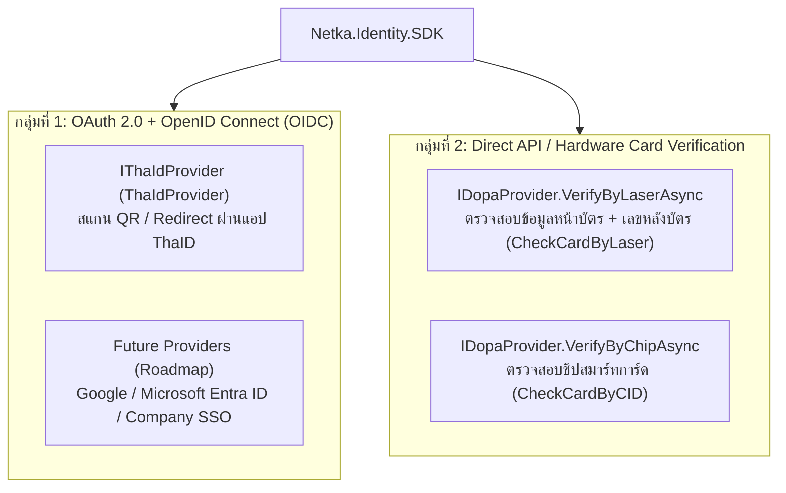

# Architecture & Technical Analysis — `Netka.Identity.SDK`

เอกสารฉบับนี้สรุปการวิเคราะห์เชิงสถาปัตยกรรม เหตุผลในการออกแบบ และรูปแบบโปรโตคอลของ **`Netka.Identity.SDK`** สำหรับระบบยืนยันตัวตนผ่านเว็บและตู้ Kiosk ของทีม Netka

---

## 1. การจำแนกประเภทโปรโตคอลยืนยันตัวตน (Protocol Classification)

จากการวิเคราะห์มาตรฐานสากลและระบบภาครัฐของไทย การยืนยันตัวตนในระบบตู้ Kiosk และ Web Application แบ่งออกเป็น **2 รูปแบบหลัก** ซึ่งทำงานต่างกันอย่างชัดเจน:

### กลุ่มที่ 1: OAuth 2.0 + OpenID Connect (OIDC) — `IThaIdProvider`
* **OAuth 2.0 คือท่อส่งสิทธิ์ (Authorization Framework):** ทำหน้าที่สร้างลิงก์ขอนุญาต (`/auth`), รับ `code` กลับมาแลก `access_token` และ `refresh_token` (`/token`), รวมถึงการตรวจสอบ (`/token/inspect`) และยกเลิก (`/token/revoke`) Token
* **OpenID Connect (OIDC) คือส่วนเสริมยืนยันตัวตนที่ครอบอยู่บนท่อ OAuth 2.0:** เมื่อส่ง `scope` ที่มีคำว่า `openid` ไปในท่อ OAuth 2.0 เดิม ระบบของกรมการปกครอง (ThaID) จะแนบ **`id_token`** (ข้อมูลตัวตนแบบ JWT) กลับมาพร้อมกับ `access_token` ทันที และเปิดให้ดึงข้อมูลประชาชนเพิ่มเติมผ่านเส้นมาตรฐาน **`/userinfo`**
* **การขยายผลในอนาคต (Roadmap):** ผู้ให้บริการอย่าง Google, Microsoft Entra ID หรือระบบ SSO ภายในองค์กร ล้วนใช้โปรโตคอลกลุ่มที่ 1 นี้ทั้งหมด จึงสามารถใช้ชื่อแพ็กเกจ `Netka.Identity.SDK` รองรับได้ต่อเนื่องโดยไม่ต้องเปลี่ยนโครงสร้าง

### กลุ่มที่ 2: Direct API / Hardware Verification — `IDopaProvider`
* สำหรับตู้ Kiosk ที่มีเครื่องอ่านบัตรสมาร์ทการ์ด (Smart Card Reader) หรือการกรอกข้อมูลหน้าบัตรคู่กับเลขหลังบัตร (Laser ID) จะ **ไม่ได้ใช้การ Redirect หน้าเว็บแบบ OAuth/OIDC**
* แต่เป็นการยิง REST API แบบ Server-to-Server ไปยังบริการ **Check Card Service ของกรมการปกครอง (DOPA)** โดยตรง เพื่อตรวจสอบว่าบัตรประชาชนใบนั้นมีสถานะปกติ ไม่ถูกระงับ หรือไม่ถูกจำหน่ายเนื่องจากทำบัตรใหม่

---

## 2. ทำไมต้องออกแบบเป็น Stateless Pass-Through Adapter? (เปรียบเทียบกับ Open-Source ทั่วไป)

ในการออกแบบ SDK นี้ ได้วิเคราะห์เปรียบเทียบกับไลบรารีมาตรฐานในโลก .NET 2 รูปแบบ:

| มิติการเปรียบเทียบ | `AspNet.Security.OAuth.Providers` | `titarenko/OAuth2` | **`Netka.Identity.SDK` (ของเรา)** |
| :--- | :--- | :--- | :--- |
| **ลักษณะการทำงาน** | ASP.NET Core Authentication Middleware | Pure C# OAuth 1.0/2.0 Client | **Stateless Clean Architecture SDK** |
| **การจัดการ Cookie / Session** | บังคับผูกกับ `HttpContext` และฝัง Cookie ล็อกอินเข้าเว็บให้อัตโนมัติ | ไม่ยุ่งกับ Cookie คืนค่าเป็น Object | **ไม่ยุ่งกับ Cookie/Session** คืนค่า `VerificationResult` เพื่อให้เอาไปบันทึก DB หรือส่งต่อให้แอปอื่นได้อิสระ |
| **การจัดการข้อมูลที่ได้รับ (Payload)** | แปลงเป็น `ClaimsPrincipal` | แปลงเป็นโมเดลกลาง `UserInfo` (มีแค่ชื่อ/อีเมล/รูป ทำให้ฟิลด์ภาครัฐหาย) | **Pass-Through 100% (`result.Data`)** ส่งคืนข้อมูลต้นฉบับครบทุกฟิลด์ (เช่น `pid`, ชื่อไทย/อังกฤษ, ที่อยู่ทะเบียนบ้าน, `laser`) |
| **การรองรับระบบภาครัฐไทย** | ไม่รองรับ DOPA Smart Card | ไม่รองรับ DOPA Smart Card | **รองรับทั้ง ThaID (6 เส้น) + DOPA Card (Laser & Chip) + ตรวจเลขบัตร 13 หลัก** |

---

## 3. การตัดสินใจเชิงสถาปัตยกรรมที่สำคัญ (Key Architectural Decisions)

### 3.1 แยก Interface ชัดเจนตามฟีเจอร์ (`IThaIdProvider`, `IDopaProvider`) แต่คืนค่าแพทเทิร์นเดียวกัน (`VerificationResult`)
* **ปัญหาของการใช้เมธอดเดียวครอบจักรวาล:** หากบีบทุกอย่างไว้ใน `VerifyAsync(VerificationRequest)` เพียงเมธอดเดียว ผู้เรียกใช้งานจะต้องเดาคีย์ใน `Dictionary` เองว่าจะต้องส่ง `"action": "refresh"` หรือ `"action": "inspect"` และส่งพารามิเตอร์ชื่ออะไร
* **ทางออกที่ใช้ใน `Netka.Identity.SDK`:**
  * สร้าง [`IThaIdProvider`](file:///d:/Work/NKS-Kiosk-Config/NKS-Kiosk-Identity-SDK/Core/Interfaces/IThaIdProvider.cs) และ [`IDopaProvider`](file:///d:/Work/NKS-Kiosk-Config/NKS-Kiosk-Identity-SDK/Core/Interfaces/IDopaProvider.cs) ที่ระบุชื่อเมธอดและพารามิเตอร์ของแต่ละเส้นอย่างชัดเจน (ดูจาก IntelliSense ก็รู้ทันทีว่าแต่ละเส้นรับค่าอะไร)
  * ทั้งสอง Interface สืบทอดจาก [`IVerificationProvider`](file:///d:/Work/NKS-Kiosk-Config/NKS-Kiosk-Identity-SDK/Core/Interfaces/IVerificationProvider.cs) และ **ทุกเมธอดคืนค่าเป็น [`VerificationResult`](file:///d:/Work/NKS-Kiosk-Config/NKS-Kiosk-Identity-SDK/Core/Models/VerificationResult.cs) เหมือนกันทั้งหมด** ทำให้ฝั่งคนเรียกใช้เขียนโค้ดรับผลลัพธ์ (`result.IsSuccess`, `result.Data`, `result.Error`) ด้วยแพทเทิร์นเดียวทั้งระบบ

### 3.2 Pass-Through Adapter Principle (ไม่ดัดแปลงผลลัพธ์จาก Provider)
* SDK ทำหน้าที่จัดเตรียม Network Configuration (Timeout, Polly Retry, Circuit Breaker, SSL Certificate Validation สำหรับเครื่อง UAT), ประกอบ HTTP Header (`Basic` / `Bearer`) และแปลง JSON Response กลับมาเป็น `IDictionary<string, object>` ของชนิดข้อมูลพื้นฐานใน C# (`string`, `long`, `double`, `bool`)
* **ไม่มีการตัด Token ทิ้ง และไม่มีการยัดฟิลด์ปลอมเพิ่มเข้าไปใน `result.Data`** เพื่อให้ฝั่ง Web Backend มีอิสระเต็มที่ในการตัดสินใจว่าจะเก็บข้อมูลใดลงฐานข้อมูล หรือจะส่งเฉพาะฟิลด์ใดกลับไปให้หน้าบ้าน

### 3.3 ความปลอดภัยและ PDPA (Tri-Log Strategy & AES-256-CBC + HMAC-SHA256)
* ใช้ [`AesEncryptionService`](file:///d:/Work/NKS-Kiosk-Config/NKS-Kiosk-Identity-SDK/Infrastructure/Security/AesEncryptionService.cs) ที่พัฒนาด้วย .NET 10 Native Crypto APIs (`Aes.EncryptCbc`, `Aes.DecryptCbc`, `HMACSHA256.HashData`, `CryptographicOperations.FixedTimeEquals`)
* ทุกครั้งที่มีการยืนยันตัวตนสำเร็จ [`ProviderHelper.LogEncryptedPiiIfPresent`](file:///d:/Work/NKS-Kiosk-Config/NKS-Kiosk-Identity-SDK/Infrastructure/Helpers/ProviderHelper.cs#L197-L220) จะเข้ารหัสเลขประจำตัวประชาชน (`pid`) ก่อนบันทึกลง `[PII-VAULT]` Log เพื่อไม่ให้มีเลขบัตรประชาชนหลุดเป็น Plaintext ในไฟล์ Log

### 3.4 HTTP Resilience Pipeline ผ่าน `IHttpClientFactory`
* ผูกนโยบาย **Polly Retry** (ลองใหม่สูงสุด 3 ครั้งแบบ Exponential Backoff เมื่อเกิด Network Error หรือ HTTP 5xx / 408) และ **Circuit Breaker** (ตัดวงจรพัก 30 วินาทีเมื่อล้มเหลวติดต่อกัน 5 ครั้ง) ไว้ใน [`DependencyInjection.cs`](file:///d:/Work/NKS-Kiosk-Config/NKS-Kiosk-Identity-SDK/Application/DependencyInjection.cs) เพื่อให้สถานะของ Circuit Breaker ทำงานร่วมกันทั้งแอปพลิเคชันอย่างถูกต้อง
