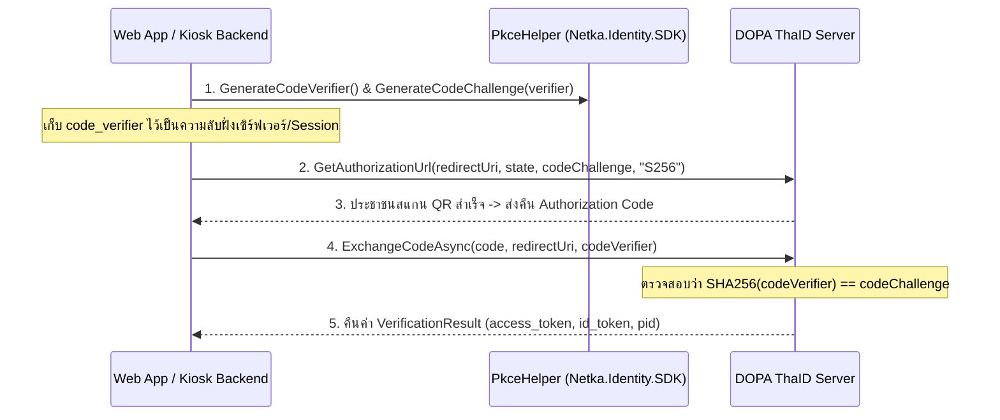

# PKCE (Proof Key for Code Exchange) Implementation Guide — `Netka.Identity.SDK`

**RFC 7636 — มาตรฐานความปลอดภัยเพิ่มเติมสำหรับ OAuth 2.0 / OpenID Connect (`IThaIdProvider`)**

---

## 1. ภาพรวม (Overview)

**PKCE** (อ่านว่า *"พิกซี่"* — Proof Key for Code Exchange) คือกลไกป้องกันการดักขโมย Authorization Code ระหว่างทาง (**Authorization Code Interception Attack**) ในการเชื่อมต่อ OAuth 2.0 / OIDC เช่น การสแกน QR Code หรือ Redirect ผ่านแอป **ThaID** บนหน้าเว็บและตู้ Kiosk



---

## 2. คลาสและเมธอดที่เกี่ยวข้องใน `Netka.Identity.SDK`

### 2.1 `PkceHelper` (`Netka.Identity.Infrastructure.Security`)

```csharp
using Netka.Identity.Infrastructure.Security;

public static class PkceHelper
{
    // 1. สุ่มสร้างรหัสลับ code_verifier (ความยาว 43-128 ตัวอักษร ค่าเริ่มต้น 128)
    public static string GenerateCodeVerifier(int length = 128);

    // 2. คำนวณค่า code_challenge ด้วย SHA-256 Base64Url (S256)
    public static string GenerateCodeChallenge(string codeVerifier);

    // 3. ตรวจสอบรูปแบบตัวอักษรของ code_verifier ตามมาตรฐาน RFC 7636
    public static bool IsValidCodeVerifier(string codeVerifier);

    // 4. ตรวจสอบรูปแบบ Base64Url ของ code_challenge
    public static bool IsValidCodeChallenge(string codeChallenge);

    // 5. ตรวจสอบว่า code_verifier ตรงกับ code_challenge แบบ Constant-Time
    public static bool VerifyCodeChallenge(string codeVerifier, string expectedCodeChallenge);
}
```

### 2.2 การเรียกใช้งานผ่าน `IThaIdProvider` (`Netka.Identity.Core.Interfaces`)

```csharp
using Netka.Identity.Core.Interfaces;
using Netka.Identity.Core.Models;

public interface IThaIdProvider : IVerificationProvider
{
    // ส่ง codeChallenge และ codeChallengeMethod ("S256") ตอนสร้าง URL
    string GetAuthorizationUrl(
        string redirectUri,
        string state,
        string? codeChallenge,
        string codeChallengeMethod = "S256",
        string? nonce = null);

    // ส่ง codeVerifier ตอนนำ code ไปแลก Token
    Task<VerificationResult> ExchangeCodeAsync(
        string authorizationCode,
        string? redirectUri = null,
        string? codeVerifier = null,
        CancellationToken cancellationToken = default);
}
```

---

## 3. ตัวอย่างการใช้งานจริงใน Web App / Kiosk Controller

### ขั้นตอนที่ 1: สร้างลิงก์เข้าสู่ระบบหรือ QR Code พร้อมแนบ `code_challenge`

```csharp
using Netka.Identity.Core.Interfaces;
using Netka.Identity.Infrastructure.Security;
using Microsoft.AspNetCore.Mvc;

[ApiController]
[Route("api/identity/thaid")]
public class ThaIdKioskController : ControllerBase
{
    private readonly IThaIdProvider _thaId;

    public ThaIdKioskController(IThaIdProvider thaId)
    {
        _thaId = thaId;
    }

    [HttpGet("start")]
    public IActionResult StartThaIdVerification()
    {
        // 1. สร้างคู่รหัส PKCE
        string codeVerifier = PkceHelper.GenerateCodeVerifier();
        string codeChallenge = PkceHelper.GenerateCodeChallenge(codeVerifier);
        string state = Guid.NewGuid().ToString("N");

        // 2. เก็บ codeVerifier และ state ไว้ใน Session / Cache ของฝั่ง Backend
        HttpContext.Session.SetString("pkce_verifier", codeVerifier);
        HttpContext.Session.SetString("oauth_state", state);

        // 3. สร้าง URL สำหรับแสดง QR Code หรือ Redirect
        string authUrl = _thaId.GetAuthorizationUrl(
            redirectUri: "https://kiosk.local/api/identity/thaid/callback",
            state: state,
            codeChallenge: codeChallenge,
            codeChallengeMethod: "S256");

        return Ok(new { authorizationUrl = authUrl, state });
    }
```

### ขั้นตอนที่ 2: รับ `code` จาก Callback และส่ง `code_verifier` ไปแลก Token

```csharp
    [HttpPost("callback")]
    public async Task<IActionResult> HandleCallback(
        [FromQuery] string code,
        [FromQuery] string state,
        CancellationToken ct)
    {
        string? expectedState = HttpContext.Session.GetString("oauth_state");
        string? codeVerifier = HttpContext.Session.GetString("pkce_verifier");

        // 1. ตรวจสอบ State เพื่อป้องกัน CSRF
        if (string.IsNullOrEmpty(expectedState) || state != expectedState)
        {
            return BadRequest(new { error = "INVALID_STATE", message = "CSRF state mismatch." });
        }

        // 2. นำ code + codeVerifier ไปแลก Token ผ่าน IThaIdProvider
        var tokenResult = await _thaId.ExchangeCodeAsync(
            authorizationCode: code,
            redirectUri: "https://kiosk.local/api/identity/thaid/callback",
            codeVerifier: codeVerifier,
            cancellationToken: ct);

        // ล้างค่า Session ทันทีหลังใช้งานเสร็จ
        HttpContext.Session.Remove("pkce_verifier");
        HttpContext.Session.Remove("oauth_state");

        if (!tokenResult.IsSuccess)
        {
            return BadRequest(tokenResult.Error);
        }

        // 3. นำข้อมูลที่ได้จาก tokenResult.Data ไปบันทึกลง Database หรือส่งต่อได้ทันที
        return Ok(tokenResult.Data);
    }
}
```

---

## 4. ข้อควรระวังด้านความปลอดภัย (Security Best Practices)

| ข้อห้าม (❌ Do Not) | แนวทางที่ถูกต้อง (✅ Best Practice) |
| :--- | :--- |
| ห้ามส่ง `code_verifier` ไปใน Authorization URL ตอนเริ่มต้น | ส่งเฉพาะ **`code_challenge`** ใน URL และเก็บ `code_verifier` ไว้ส่งใน POST Body ตอนแลก Token เท่านั้น |
| ห้ามใช้โหมด `"plain"` ในระบบ Production | ใช้ **`"S256"`** (`PkceHelper.GenerateCodeChallenge(verifier)`) เสมอ |
| ห้ามเขียนค่า `code_verifier` ลงในไฟล์ Log | เขียนเฉพาะผลการตรวจสอบ และใช้ `[PII-VAULT]` สำหรับข้อมูลส่วนบุคคล |
| ห้ามใช้ `code_verifier` ซ้ำในการล็อกอินครั้งถัดไป | สุ่มใหม่ทุกครั้งด้วย `PkceHelper.GenerateCodeVerifier()` ต่อการยืนยันตัวตน 1 รอบ |
