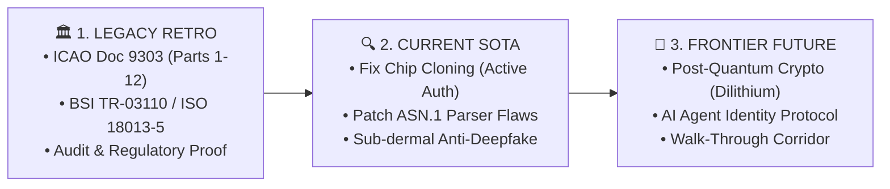

# 📑 บทสรุปงานวิจัยภาพรวม: Tri-Temporal Research Executive Synthesis
## รายงานสังเคราะห์ผลการวิจัยทั้ง 3 มิติเวลา (Legacy • Current • Future)
**เรียน: ท่านประธานเจ้าหน้าที่บริหาร (CEO) และคณะกรรมการยุทธศาสตร์**
**จัดทำโดย: ทีมวิจัย Tri-Temporal Research Pillar (Pillar 02)**

---

---

### 1. สรุปความเชื่อมโยงของทั้ง 3 มิติวิจัย

| มิติเวลา | บทบาทหน้าที่ | ประโยชน์ทางตรงต่อ TUM | เอกสารฉบับเต็ม |
| :--- | :--- | :--- | :--- |
| **1. Legacy Retro** *(อดีตและมาตรฐาน)* | รวบรวมมาตรฐานสากล ICAO 9303, ISO/IEC 7816, ISO 18013-5, FIPS 140-3, BSI TR-03110 | สร้างความชอบธรรมและความน่าเชื่อถือทางกฎหมาย (Audit-Ready) สำหรับประกวดราคาภาครัฐ ธนาคาร และสนามบิน | [`01_LEGACY_STANDARDS_AND_COMPLIANCE_REPORT.md`](file:///d:/Work/NKS-Kiosk-Config/NKS-Kiosk-Identity-SDK/docs/research/01_LEGACY_STANDARDS_AND_COMPLIANCE_REPORT.md) |
| **2. Current SOTA** *(ปัจจุบันและภัยคุกคาม)* | เจาะลึกจุดบกพร่องตลาด ชิปโคลนนิ่ง ช่องโหว่ CVE และข้อผิดพลาดของ Parser ในระบบคู่แข่ง | นำบทเรียนมาอุดช่องโหว่ทันทีใน Phase 1 ทำให้ระบบของเราไร้ข้อบกพร่องและเร็วกว่าคู่แข่ง 5-10 เท่า | [`02_CURRENT_SOTA_MARKET_CVE_GAP_REPORT.md`](file:///d:/Work/NKS-Kiosk-Config/NKS-Kiosk-Identity-SDK/docs/research/02_CURRENT_SOTA_MARKET_CVE_GAP_REPORT.md) |
| **3. Frontier Future** *(อนาคตและนวัตกรรมใหม่)* | ค้นคว้า Post-Quantum Cryptography (NIST Dilithium), zk-SNARKs และ AI Agent Trust | เสนอ 3 ผลิตภัณฑ์ใหม่ (**TUM QS-ID**, **TUM Agentic Trust**, **Walk-Through Corridor**) ปูทางสู่ DeepTech Unicorn | [`03_FRONTIER_FUTURE_HORIZONS_AND_NEW_PRODUCTS.md`](file:///d:/Work/NKS-Kiosk-Config/NKS-Kiosk-Identity-SDK/docs/research/03_FRONTIER_FUTURE_HORIZONS_AND_NEW_PRODUCTS.md) |

---

### 2. มติข้อเสนอแนะเชิงปฏิบัติการสำหรับ Phase 2

1. **สำหรับทีมวิศวกรรม (Engineering):**
   * ในการทำ NuGet Package และ Quickstart ให้ใช้เอกสาร Legacy Standards อ้างอิง docstrings ให้ชัดเจน
   * นำข้อเสนอแนะเรื่อง **Strict Active Authentication Fallback** และ **Anti-Replay Nonce Validation** จากทีม Current SOTA ไปใส่ไว้ใน Checklist การส่งมอบงาน
2. **สำหรับทีมพัฒนาธุรกิจและการตลาด (Business & Sales):**
   * นำผลวิเคราะห์เปรียบเทียบจุดอ่อนของระบบ Cloud Identity แบบเดิม ไปใส่ไว้ใน Sales Pitch Handout
   * เริ่มนำเสนอคอนเซ็ปต์ **TUM Quantum-Safe Identity (QS-ID)** และ **AI Agent Trust Gateway** ให้กับลูกค้าระดับสูงเพื่อวัดความต้องการ (Pre-order / Pilot interest)
